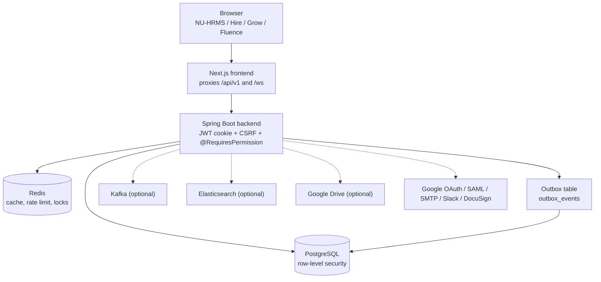

# NU-AURA: Handover and Requirements Document

**NULogic Technologies | Product: NU-AURA (NU-HRMS, NU-Hire, NU-Grow, NU-Fluence)**
**Snapshot: 2026-11-20 | Repository: `fayaz-deen/main` at commit `c4498f7e` | Status: release verdict NOT re-issued (last stated verdict: NO-GO, 2026-11-15)**

## How to use this document

This is the single source for what NU-AURA is, how it behaves, what has been done, what is not done, what is needed from the owner, and what must happen before real users log in. Section 5 holds the requirements register (R-001 onward) so it can be copied into a new requirements file.

| Section | Answers |
|---|---|
| 1. What NU-AURA is and how it behaves | What the product is, who uses it, architecture, how to run it |
| 2. What has been done | Fixes, verification evidence, decisions already taken |
| 3. What is NOT done | Open defects, gaps, never-tested areas, accepted risks |
| 4. What I need from you, and what unblocks real users | Owner inputs, decisions, go-live checklist, definition of done |
| 5. Requirements register and appendix | R-001 to R-049, release gates, run/test commands, file map, glossary, commit index |

**Reading rules**
- Where two source documents disagree, the later dated one is used. The register `docs/release-readiness/evidence/bug-register.md` is append-only: its dated rows at the bottom supersede its earlier rows and its header.
- "Not verified" means no file, command result or test in this repo proves it. It never means "fine".
- The external Codex and Grok review (A7) has NOT been run. The internal review mentioned in section 2 is not a substitute.
- No secrets appear in this document. Credentials are named by setting, never by value.
- "Memory" in this document means the Claude project memory (`~/.claude/projects/.../memory/`). It is a source, not proof. Older memory notes can be stale: always check against the repo.

**Where this document may be out of date by the time you read it**
- Commits after `c4498f7e`. Check `git log --oneline` against the commit index in Appendix D.
- The executive summary (`00-executive-summary.md`) and go/no-go (`16-release-go-no-go.md`) bodies predate the fixes; a dated status block sits at the top of each.
- The Obsidian note `NU-AURA Release Readiness.md` (HEAD about `c0e483a3`, migrations to V354) and the repo-root `MEMORY.md` (Spring Boot 3.4.1, Java 17, 8 demo users) are stale. Use this document and `pom.xml` / `package.json` instead.
- A list of facts nobody has proven is in section 3.8 and in the Document control block at the end.

---
# 1. What NU-AURA is and how it behaves

Sources: repo files, project memory, the Obsidian vault and read-only file counts. Anything not proven by a file is marked "not verified". The older vault notes (2026-06-18) and the release-readiness summary (2026-11-15) are partly stale. Where numbers differ, the newer source is used and its date is shown.

---

## 1.1 Purpose and the four apps

NU-AURA is NULogic's multi-tenant HR and people platform. One company (a "tenant") gets one login and four apps in one shell. The stated business goal is to replace the paid Keka subscription (`docs/release-readiness/16-release-go-no-go.md`). Whether it can do that safely today is a separate question: the 2026-11-15 verdict was NO-GO and has not been re-issued (see section 2.1).

| App | What it does | Main screens / modules | Who uses it |
|---|---|---|---|
| NU-HRMS | Core HR record of truth. Employees, attendance, shifts, leave, payroll, compensation, benefits, expenses, loans, assets, travel, letters, helpdesk, statutory/tax, org structure, timesheets and projects. | `/me/dashboard` (entry), `/employees`, `/attendance`, `/leave`, `/payroll`, `/expenses`, `/assets`, `/letters`, `/helpdesk`, `/statutory`, `/tax`, `/timesheets`, `/projects`, `/departments`, `/reports` | Every employee (self-service), managers (approvals), HR and payroll staff (operations) |
| NU-Hire | Recruitment and joining. Job openings, candidate pipeline (kanban), interviews and scorecards, public careers page, agencies, AI resume assist, preboarding, onboarding checklists, offers and e-signature, referrals. | `/recruitment/*`, `/careers/*`, `/preboarding`, `/onboarding`, `/offer-portal`, `/referrals`, `/sign` | Recruiters, hiring managers, interviewers, external candidates |
| NU-Grow | Growth loop for existing employees. Goals and OKRs, performance review cycles, 360 feedback, 1-on-1s, training and LMS, recognition, surveys, wellness. | `/performance`, `/okr`, `/feedback360`, `/one-on-one`, `/training`, `/learning`, `/recognition`, `/surveys`, `/wellness` | Employees, managers, LMS admins, HR |
| NU-Fluence | Company knowledge hub. Wiki spaces, blogs, templates, drive, activity wall (posts, reactions, praise), unified search, AI chat (RAG with citations). | `/fluence/*` (wiki, blogs, templates, drive, wall, search, ai-chat, analytics) | All employees; editors and admins for content |

Notes:
- The app boundary is declared in `frontend/lib/config/apps.ts` (route prefixes and permission prefixes per app). Source: `docs/obsidian/02-Modules/Nu-*.md`.
- A cross-app personal portal lives under `frontend/app/me/*`.
- A shared platform layer (auth, roles, notifications, integrations, feature flags, tenancy, storage) serves all four apps: `docs/obsidian/02-Modules/Shared-Platform.md`.

---

## 1.2 Users and roles

### The roles
The vault (`docs/obsidian/05-RBAC/Roles.md`, verified 2026-06-18 against `RoleHierarchy.java`) lists **26 roles: 19 explicit and 7 implicit**. Memory's "9 roles" is the core subset.

| Group | Roles (rank, higher is more powerful) |
|---|---|
| Platform | SUPER_ADMIN (100): cross-tenant, bypasses all gates |
| Tenant and HR | TENANT_ADMIN (90), HR_ADMIN (85, can edit salary and bank), HR_MANAGER (80, can view salary), HR_EXECUTIVE (70, no financial access) |
| Specialist admins | PAYROLL_ADMIN (75), RECRUITMENT_ADMIN (65), PROJECT_ADMIN (58), ASSET_MANAGER (56), EXPENSE_MANAGER (55), HELPDESK_ADMIN (54), TRAVEL_ADMIN (53), COMPLIANCE_OFFICER (52), LMS_ADMIN (51) |
| Line management | DEPARTMENT_MANAGER (60), TEAM_LEAD (50) |
| Staff | EMPLOYEE (40), CONTRACTOR (30), INTERN (20) |
| Implicit (derived from relationships, added automatically) | REPORTING_MANAGER, SKIP_LEVEL_MANAGER, DEPARTMENT_HEAD, MENTOR, INTERVIEWER, PERFORMANCE_REVIEWER, ONBOARDING_BUDDY |

Core nine: SUPER_ADMIN, TENANT_ADMIN, HR_ADMIN, HR_MANAGER, HR_EXECUTIVE, DEPARTMENT_MANAGER, TEAM_LEAD, EMPLOYEE, CONTRACTOR.

Other facts:
- Roles are tenant rows in the `roles` table. Each tenant gets its own seeded set. Tenants can add custom roles.
- TENANT_ADMIN includes HR_ADMIN, which includes HR_MANAGER. Specialist admins do not inherit from each other.
- Implicit roles are stored in `implicit_user_roles` (V63) and merged at load time.
- Roughly 500+ permissions exist, written `MODULE:ACTION` (for example `EMPLOYEE:READ`, `ROLE:READ`). A migration seeded 221 in memory's 2026-06-24 note; the vault says 500+. The exact current count is not verified.

### Scopes
Each permission carries a data scope. Order from widest to narrowest: ALL, LOCATION, DEPARTMENT, TEAM, SELF, CUSTOM. Plain meaning:

| Scope | Rows the user can see or act on |
|---|---|
| SELF | Their own records only |
| TEAM | Their reporting line |
| DEPARTMENT | Their department |
| LOCATION | Their office location |
| ALL | The whole tenant |
| CUSTOM | A configured set |

An empty scope returns zero rows. It does not fall back to SELF (`DataScopeService`, per `Security-Audit.md`).

### How one permission check works, end to end
1. Browser sends a request with the JWT httpOnly cookie, the CSRF header and tenant header.
2. Spring Security validates the token and resolves the tenant. Rate limit applies first.
3. The JWT carries **roles only**. Permissions are loaded from the database through a Redis cache (`SecurityService.getCachedPermissionsForUser`). So a permission change applies without re-login once the cache is evicted.
4. `PermissionHandlerInterceptor` checks `@RequiresPermission` on the controller method. About 1,750 usages exist (vault count, 2026-06-18).
5. `PermissionAspect` re-checks the same annotation on service-to-service calls.
6. Implied permissions widen access: `MODULE:READ` implies `MODULE:VIEW_*`, and `VIEW_ALL > VIEW_TEAM > VIEW_DEPARTMENT > VIEW_SELF`.
7. The repository query is filtered by the data scope, then by PostgreSQL row-level security for the tenant.
8. A missing or unreadable annotation configuration denies (fail closed).
9. In the browser, `AuthGuard` and `PermissionGate` mirror the same rules to hide routes and buttons. SUPER_ADMIN bypasses frontend route checks. The frontend is a convenience; the backend is the real gate.

Known drift risk: the vault notes the backend and frontend role lists "do not fully agree" in places, and a nightly drift check plus a Playwright role-by-route sweep exist to catch it. The 2026-11-15 audit found 49 permission codes only SUPER_ADMIN holds and some roles missing in the DB (`00-executive-summary.md`). Migrations V345 and V350-V354 repaired several grants. Current completeness is not verified.

---

## 1.3 Architecture

### Stack
| Layer | Technology | Version evidence |
|---|---|---|
| Frontend | Next.js (App Router), React, TypeScript, Mantine UI, Tailwind, TanStack Query, Zustand, Axios, React Hook Form + Zod | Next 16.2, React 19.2.7, Mantine 9.3, TS 6.0 (memory, 2026-11-15) |
| Backend | Java, Spring Boot modular monolith (DDD layers api, application, domain, infrastructure) | Spring Boot 3.5.14, Java 21 (memory; local JDK was 23.0.2) |
| Database | PostgreSQL with Flyway migrations and row-level security | Local PG 16; vault says Neon for dev and PG 16 for prod; Railway beta ran PG 18.4 per memory |
| Cache and coordination | Redis 7, Bucket4j rate limiting, ShedLock | 25 named caches (vault) |
| Messaging | Kafka (6 topics plus dead-letter) with a transactional outbox | Kafka is optional; outbox is the live path on Railway and locally |
| Search | Elasticsearch 8.11, off by default (`ELASTICSEARCH_ENABLED` defaults false) | `application.yml:424` |
| Files | Google Drive via a `StorageProvider` abstraction | Beta sets `APP_STORAGE_PROVIDER=none` per memory |
| Auth | Password, Google OAuth, per-tenant SAML 2.0, TOTP MFA, API keys for machines | `SecurityConfig`, `Security-Audit.md` |
| Observability | Micrometer, Prometheus, Grafana, OTLP tracing | Stack exists in compose and K8s; Railway-side wiring not verified |
| Deploy | Docker Compose (dev), Kubernetes on GKE (manifests), GitHub Actions; live beta on Vercel and Railway | See 1.5 |

Note: `.claude/CLAUDE.md` still lists older versions in places. `pom.xml` and `package.json` win.

### Diagram

Solid lines are always on. Dotted lines depend on configuration.

### Multi-tenancy and row-level security
- Every request resolves a tenant. `TenantContext` carries it through threads, async work and scheduled jobs.
- Each database transaction sets `app.current_tenant_id` locally (`TenantRlsTransactionManager`).
- PostgreSQL row-level security policies enforce the tenant at the row. The runtime role must be `nu_app_rls` (no bypass). `RlsStartupProbe` can refuse to start on a bypass-capable role.
- A test (`RlsTenantGucScopeTest`) blocks session-wide settings that would leak a tenant across pooled connections. A real leak of that kind was fixed in commit `0ea63f6e` (memory).
- Cache keys, rate-limit buckets and search queries are tenant-prefixed.
- Verified locally only. A true two-tenant check was not possible because the second tenant has no users (`00-executive-summary.md`, 2026-11-20 block).

### Auth, cookies, JWT, CSRF
- JWT is in an httpOnly, Secure cookie. It carries roles only. Access token 24 h, refresh token 30 days, rotated.
- Logout and rotation revoke tokens through `TokenBlacklistService` (Redis with in-memory fallback).
- CSRF uses double-submit: a readable `XSRF-TOKEN` cookie and an `X-XSRF-TOKEN` header.
- Password rules: 12+ characters, complexity, history of 5, 90-day maximum age. Account lockout after 5 failures in 15 minutes.
- Because cookies are Secure, login works only over HTTPS on hosted setups. Locally it works over plain HTTP at localhost.
- The frontend proxies `/api/v1` to the backend so the browser sees one origin.

### Rate limiting
Auth 5 per minute, API 100 per minute, exports 5 per 5 minutes, wall 30 per minute. Redis Lua scripts with a Bucket4j fallback. The auth limit is hard-coded in the `DistributedRateLimiter` enum (memory). Beta had rate limiting switched off by an environment override; current state is not verified.

### Caching
25 named caches with tiered TTLs, a warm-up job per tenant, and permission caches. Permission eviction was changed to happen after commit (memory, 2026-09-26).

### Background jobs
About 21 classes with 26 `@Scheduled` methods (vault 2026-06-18, memory 2026-11-15). They cover attendance, contracts, email, notifications, recruitment, workflows, reports, webhooks, leave accrual, tenant operations and the outbox poller. On the Railway beta profile, `APP_SCHEDULING_ENABLED` defaults to false, so accruals and emails do not fire unless it is turned on (`Deployment.md:180`).

---

## 1.4 How the app behaves in practice

### Login and app switcher
1. User opens `/login`. Options: email and password, Google sign-in, SSO if the tenant configured SAML, MFA code if enabled.
2. After login, a signed-in user visiting the login page is sent on to their destination (commit `7f72c5ea`).
3. The default landing is `/me/dashboard` (NU-HRMS home).
4. The app switcher shows only apps the user has permission for. The sidebar changes per app.
5. On every route change `AuthGuard` checks the session. If the session is gone it tries `/auth/me`, then `/auth/refresh`, and otherwise sends the user to login with `reason=expired`.

### Typical flows
| Role | What they do | What happens |
|---|---|---|
| Employee | Check in, apply for leave, view payslips, raise helpdesk tickets, file expenses, log timesheets, read wiki, post on the wall | Own data only (SELF scope). Requests go to the manager or HR. |
| Manager | Approve leave, expenses, timesheets, regularisations; run 1-on-1s and reviews | Sees the team scope. Approvals go through the workflow engine. Single-admin tenants raise a product question about same-user process and approve. |
| HR admin | Onboard and offboard people, manage leave types, letters, documents, policies, announcements, reports, roles | Tenant-wide scope. Some salary and bank actions need HR_ADMIN rather than HR_MANAGER. |
| Payroll admin | Run payroll, payslips, statutory and tax items | See 1.6 and the release verdict: statutory filings and TDS are not release-ready. |
| Recruiter | Post a job, add candidates, move them on the pipeline board, schedule interviews, send an offer, hand off to onboarding | Candidate status and pipeline stay in step for board moves, offer events and returning candidates (commits `5986cc93`, `8cfbed9d`, `c4498f7e`). One drift remains: candidate edits outside the offer flow do not update the applicant (section 3.2.2). Conversion of a candidate to an employee record was a known gap on 2026-11-15; current state not verified. |
| Performance and OKR | Employees set objectives and key results; managers run review cycles and 360 feedback | Objective create and key-result add were browser-verified locally (`11-browser-e2e.md`). |
| Learning | Employees enrol in courses and track progress | Completed enrolments now stay at 100 percent (commit `65f06165`, migration V355 repaired old rows). |
| Wiki and wall | Write pages and blogs, post praise, search, ask the AI chat | AI chat needs the `KNOWLEDGE:SEARCH` permission. Wiki visibility rules for TEAM and RESTRICTED spaces were open gaps on 2026-11-15. |

### Error, denied and empty states
| Situation | Behaviour |
|---|---|
| 401 (not signed in or token expired) | Axios interceptor runs one shared refresh. If refresh fails, the user is sent to login. Concurrent 401s share one refresh call. |
| 403 (signed in, not allowed) at route level | The route guard redirects to the home page with `denied=1`; the layout shows a one-time toast and strips the parameter (memory, 2026-06-24). In the 2026-11 browser run, 12 admin routes opened by an employee all landed on `/me/dashboard`. |
| 403 from an API call on an allowed page | Some helper calls treat 403 and 404 as "no data" instead of an error. The browser run logged a few such 403s on employee and recruiter pages (for example `/okr/company/objectives`, `/letters/templates/active`). These were noted as defects or noise; their current state is not verified. |
| Inline gating | Buttons and sections are hidden (`PermissionGate`), or a page-level "denied" panel shows. While permissions load, a visible "Loading..." placeholder appears. |
| Empty lists | Pages render empty states. A 2026-11 sweep fixed error and empty states on several pages; full coverage not verified. |
| Server error (5xx) | Query reads retry once, writes never retry automatically. A global error boundary exists (`error.tsx`, `global-error.tsx`). Timeouts: 30 s reads, 120 s writes. |
| Rate limit | HTTP 429 from the backend. |

### Notifications and email
- In-app notifications and real-time updates run through WebSocket (STOMP) and a Redis relay across pods.
- Email, SMS and Slack are optional channels with per-user preferences.
- Email needs SMTP settings. The default host in `application.yml` is `smtp.gmail.com` and credentials come from environment variables. Locally SMTP is not configured, so the mail health check is DOWN and the overall `/actuator/health` returns 503 while liveness and readiness stay UP (`13-deployment-readiness.md`).
- Memory (2026-06-25) lists "email/SMTP not configured, so password reset and notifications are broken" as a real-user blocker on the hosted beta. Whether that was later fixed is not verified.
- Event delivery uses the outbox table, polled every 5 seconds, max 5 retries, then FAILED. There is no alert or replay for failed rows (known defect DEF-14).

---

## 1.5 Environments and how to run it

### Ports
Design: frontend 3000, backend 8080. In the 2026-11 local test run the frontend ran on **3001** because another app held port 3000 (`17-e2e-browser-test-plan.md`, row P0). The test scripts used a `FE_URL` override. Check which port the frontend actually took before testing.

### Local run recipe (memory, verified 2026-11-15)
- Start everything with `~/.config/nu-aura/start-all.sh`. It starts Redis and PostgreSQL 16 through Homebrew if down, then frontend and backend. Logs: `frontend-session.log` and `backend-session.log` in the repo root.
- Backend only: `~/.config/nu-aura/run-be.sh`. Backend takes about 60-90 seconds.
- Credentials live in `~/.config/nu-aura/local-db.env` (permissions 600). Not read or reproduced here. A second file, `~/.config/nu-aura/tenant-test.env`, also exists (name only).
- The repo's own `start-backend.sh` fails with the current `.env` (points at a Postgres on 5433 that does not exist locally). `run-be.sh` works around it. The repo `.env` was deliberately not read or edited.
- Local database: Homebrew PostgreSQL 16 on 5432, database `hrms_dev`; also an audit database and the RLS role `nu_app_rls`.
- Flyway must run as a superuser locally. The app user hit a row-level-security error at V329.
- Kafka is off locally: Kafka disabled, outbox enabled, Kafka auto-configuration excluded. Turning both on makes `KafkaOutboxMutualExclusionGuard` abort startup.
- Never use the `render` profile locally: Flyway reports a checksum mismatch.
- Health: `curl localhost:8080/actuator/health` (mail DOWN is expected). `/api/v1/auth/me` returning 401 when signed out is expected.
- Stop: kill the processes on ports 3000 (or 3001) and 8080.
- Real-browser login needs `NEXT_PUBLIC_API_URL=http://localhost:8080/api/v1` in the `.env`. The file currently points at the Docker host name (`http://backend:8080/...`), which a real browser cannot resolve. The test scripts reroute that host to localhost, so they pass while a human login fails. This is an owner action: see section 4.1.1.
- Login rate limit is 5 bad logins per minute per IP; the 6th gets 429. Refresh tokens are single use, so a saved test session stops working once its access token expires. Never run `mvn clean` while the backend jar is running (the jar lives in `backend/target/`). Details and commands: Appendix A.
- Backend integration tests need Docker (Colima socket symlink per memory). They had not run as of 2026-11-20.

### Demo accounts
- The seeded demo tenant (NuLogic) has demo accounts at `@nulogic.io`. All share one demo password, which is not written here (it is in the runbook). Roles seeded per `docs/qa/AUTONOMOUS-UI-E2E-RUNBOOK.md` (verify each by logging in before relying on it):

| Account (before `@nulogic.io`) | Role | Used for |
|---|---|---|
| `arun`, `anshuman` | EMPLOYEE | Employee baseline (test alias EMP = `arun`) |
| `saran` | EMPLOYEE plus HR_ADMIN (per auth inventory) | HR admin screens |
| `raj` | EMPLOYEE plus FINANCE_ADMIN (per auth inventory) | Finance screens |
| `sumit` | MANAGER | Manager and approvals (alias MGR) |
| `mani`, `gokul`, `dhanush` | TEAM_LEAD | Team-lead scope |
| `jagadeesh` | HR_MANAGER | HR operations |
| `suresh` | RECRUITMENT_ADMIN | NU-Hire admin |
| `finance` | FINANCE_ADMIN | Payroll and finance |
| `tenant.admin` | TENANT_ADMIN | Tenant administration |
| `admin` | HR admin in the test plan (alias HR; runbook says "verify on login") | Broad admin |
| two owner super-admin accounts | SUPER_ADMIN | Owner only. Never use on production. |

- Role catalogue seeded in the DB per the runbook: SUPER_ADMIN, TENANT_ADMIN, HR_ADMIN, HR_MANAGER, FINANCE_ADMIN, FINANCE_MANAGER, PAYROLL_ADMIN, RECRUITMENT_ADMIN, IT_ADMIN, MANAGER, REPORTING_MANAGER, TEAM_LEAD, EMPLOYEE. This differs from the 26-role list in 1.2 (see DEF-RBAC-05 in section 3.2.1).
- Rule from the test plan: never use real personal accounts for testing.
- Hosted production must have demo credentials off (`DEMO_CREDENTIALS_ENABLED=false`). Memory says this was set on 2026-06-24. Current value is not verified.

### Flyway migrations
- Newest migration file in the repo today: **V355** (`V355__repair_completed_enrollment_progress.sql`, checked 2026-11-20). V350-V354 add HR and manager grants.
- The local database was at V341 on 2026-11-15. The register says V355 was applied on restart on 2026-11-20 (G-010/G-011 row). The release-readiness note says "migrations run to V353" on 2026-11-20 before V354 and V355 landed.
- Files V342 to V355 are all present in the migration folder (14 files, checked 2026-11-20).
- Before picking a new number, check all branches (`git log --all --diff-filter=A`). Memory records V337-V340 existing only on release branches once.
- Fix mistakes forward with a new migration. Do not edit applied ones.

### Live deployment
| Target | What memory says | State |
|---|---|---|
| Frontend on Vercel | Project `hrms-frontend`, URL https://hrms-frontend-vert.vercel.app, proxies to the backend | Not verified current |
| Backend on Railway | Project `nu-aura`, service `nu-aura-backend`, profile `render`, Postgres, Redis; Kafka dormant | Not verified current |
| Production Flyway head | V316 (memory, 2026-06-25); readiness note says V317-V341 were not yet applied | Not verified; production was never inspected in the 2026-11 audit |
| Production service config | Lives outside git (no `railway.json`) | Not verified |

The live path uses the `render` profile; Kubernetes manifests use the `prod` profile and differ materially (defect DEF-06). Hosted dev may also use Neon (vault). Not verified.

---

## 1.6 Integrations and their state

| Integration | State | Evidence |
|---|---|---|
| Email / SMTP | Code real. Not configured locally. On hosted beta: not configured as of 2026-06-25. Current: not verified. | `application.yml`, memory, `13-deployment-readiness.md` |
| Google OAuth sign-in | Code real. Production key verification was an open blocker on 2026-06-25. Current: not verified. | memory |
| SAML SSO | Code real (per-tenant config). Never verified end to end in the audit files read. Not verified. | `Security-Audit.md` |
| Slack | Real code behind `SLACK_ENABLED`, default false. Webhook signature verified. Live use: not verified. | `application.yml:451`, `Security-Audit.md` |
| DocuSign / e-sign | Controller and webhook exist. Offer e-sign was admin-only on 2026-11-15. Live use: not verified. | `Security-Audit.md`, `00-executive-summary.md` |
| SMS (Twilio) | Real code. The `prod` profile crashes at startup without Twilio credentials, so beta uses the `render` profile. | memory (2026-06-11) |
| Elasticsearch | Opt-in, default off. Search falls back to PostgreSQL. Absent on Railway beta. | `application.yml:424`, `Deployment.md` |
| Kafka | Dormant facade on Railway and locally. Outbox is the live event path. A startup guard stops both being on. A Kafka broker was added to Railway in June, then dropped later per memory; current state not verified. | memory, `Deployment.md` |
| Google Drive storage | Behind `StorageProvider`. Beta uses `none`. Whether any hosted tenant uses Drive: not verified. A weak file-path guard was found (Medium). | memory, `00-executive-summary.md` |
| Payments (UI) | `/payments/config` page is gated by `NEXT_PUBLIC_PAYMENTS_ENABLED` and shows disabled unless that is `true`. Treat as off. | `frontend/app/payments/config/page.tsx` |
| Payroll math | Core math fixed for unpaid leave and mid-month joiners. | `15-known-defects.md` |
| Statutory filings (PF, ESI, PT) | Returns fail with HTTP 400. Open. | `15-known-defects.md` |
| TDS | Slabs are FY2024-25 with no standard deduction. Needs a chartered accountant. | `16-release-go-no-go.md` |
| Bank advice, arrears, EMI through payroll, period lock | Missing (Keka parity gaps). | `00-executive-summary.md` |
| Encryption of sensitive fields | Migration cannot complete safely (open defects DEF-03 and DEF-04). | `00-executive-summary.md` |

Plain summary: sign-in, core HR, recruitment, performance and wiki work locally. Outbound channels (email, Slack, SMS, e-sign) are coded but depend on configuration that was not proven on any hosted environment. Payroll statutory output is the largest real gap.

---

## 1.7 Codebase map

### Key folders
| Path | Contents |
|---|---|
| `frontend/app/` | Next.js routes (App Router). About 97 top-level folders. |
| `frontend/components/`, `frontend/lib/` | Shared components, hooks (`lib/hooks/queries`), config (`lib/config/apps.ts`), generated API client (`lib/generated/api`, gitignored) |
| `backend/src/main/java/com/nulogic/` | `api`, `application`, `domain`, `infrastructure`, `common` (security, config) |
| `backend/src/main/resources/db/migration/` | Flyway migrations |
| `backend/src/main/resources/application*.yml` | Base, `render`, `prod`, `demo` profiles |
| `infra/` | Docker, Kubernetes, Helm, Kyverno, monitoring |
| `docs/obsidian/` | Evidence-based knowledge vault (start at `00-Home.md`) |
| `docs/release-readiness/` | Audit, test evidence, defects, go/no-go |
| `MEMORY.md` (repo root) | Evolving project state |
| `graphify-out/`, `.ua/` | Local code graphs (gitignored); the graphify snapshot was built at commit `568b6aa3` and is stale |

### Counts
| Item | Count | Date and source |
|---|---|---|
| Pages (`page.tsx` under `frontend/app`) | 290 | 2026-11-20 file count. The P1 sweep on 2026-11-19 counted 289 app routes (249 static plus 40 dynamic) against 290 catalogue entries; the one-page difference is not reconciled |
| Components | 186 | 2026-11-15, memory (vault said 171 on 2026-06-18) |
| Controller files (`*Controller.java`) | 183 | 2026-11-20, file count in this check (memory 181 on 2026-11-15; vault 180 live on 2026-06-18) |
| Services | 242 | 2026-11-15, memory (vault 258 on 2026-06-18; the two disagree, not reconciled) |
| Entities | 323 | 2026-11-15, memory |
| Repositories | 298 | 2026-11-15, memory |
| `@Scheduled` classes | 21 (26 methods per vault) | 2026-11-15 memory / 2026-06-18 vault |
| Files in the migration folder | 344 | 2026-11-20, file count in this check |
| Newest migration | V355 | 2026-11-20 |
| Backend test classes | 429 | 2026-11-15, memory |
| Frontend unit test files | 137 | 2026-11-20, count of `*.test.ts(x)` files outside `node_modules`; matches the 137 files in the latest vitest run (memory said 117 earlier) |
| Playwright specs | 123 | 2026-11-15, memory |
| REST endpoints | 1,711 | 2026-06-18, vault; not re-counted |
| Database tables | 331 | 2026-06-18, vault; not re-counted |

Counts differ by source and date because the code keeps changing. Use the 2026-11-20 rows when a single number is needed.

### Repository state at the time of writing
- Branch `main`, latest commit `c4498f7e` (2026-11-20, "Reopen a rejected candidate when they apply again"). Per local remote-tracking refs, `fayaz-deen/main` is at this commit and `fayaz30395/main` is at `c9ee9e54` (46 commits behind; refs not fetched).
- The working tree has many uncommitted and untracked files (git status at session start). Treat the committed history as the reliable record.

---

## Sources used
- `/Users/fayaz.m/IdeaProjects/nulogic/nu-aura/CLAUDE.md`
- `/Users/fayaz.m/IdeaProjects/nulogic/nu-aura/.claude/CLAUDE.md`
- `/Users/fayaz.m/.claude/projects/-Users-fayaz-m-IdeaProjects-nulogic-nu-aura/memory/MEMORY.md`
- `.../memory/project_local_run_recipe_2026_11_15.md`, `project_hosting_stack_railway_vercel.md`, `project_stack_versions.md`
- `/Users/fayaz.m/IdeaProjects/nulogic/nu-aura/docs/obsidian/00-Home.md`
- `docs/obsidian/01-Architecture/System-Overview.md`
- `docs/obsidian/02-Modules/Nu-HRMS.md`, `Nu-Hire.md`, `Nu-Grow.md`, `Nu-Fluence.md`, `Shared-Platform.md`
- `docs/obsidian/03-Frontend/Pages.md`, `Components.md`
- `docs/obsidian/05-RBAC/Roles.md`, `Permissions.md`
- `docs/obsidian/07-DevOps/Deployment.md`, `Local-Setup.md`
- `docs/obsidian/08-Security/Security-Audit.md`
- `docs/release-readiness/00-executive-summary.md`, `11-browser-e2e.md`, `13-deployment-readiness.md`, `15-known-defects.md`, `16-release-go-no-go.md`, `17-e2e-browser-test-plan.md`
- `backend/src/main/resources/application.yml` (mail, Slack, Elasticsearch flags)
- `frontend/app/payments/config/page.tsx`
- File counts and migration listing under `frontend/app` and `backend/src/main/resources/db/migration` (read-only)
- Also read for the review: the Obsidian note `NU-AURA Release Readiness.md`, `docs/qa/AUTONOMOUS-UI-E2E-RUNBOOK.md` (account names and roles only) and repo-root `MEMORY.md` (stale). The 04-Backend and 06-Database vault notes were not read in depth.

---

# 2. What has been done (release-readiness work, 2026-11-15 to 2026-11-20)

Written for the owner, not for engineers. All paths are under `docs/release-readiness/` unless they start with `backend/` or `frontend/`. Facts come from the files, the git log and the registers named at the end. Anything unconfirmed is marked "not verified". Where two documents disagree, the later one is used and the choice is stated.

Short names: Plan = `17-e2e-browser-test-plan.md` (table A4). Register = `evidence/bug-register.md`. Fix range = `git log c9ee9e54^..HEAD`, which is 47 commits ending at `c4498f7e` (current HEAD, also on `fayaz-deen/main`).

## 2.1 Summary in 10 lines

1. On 2026-11-15 the audit said NO-GO (`00-executive-summary.md`): 451-row audit matrix, 4 Critical and about 20 High defects, 772 backend tests that could not run (no Docker).
2. A UI test pass (P0 to P7) then found 117 bug entries: 1 Critical, 23 High, 1 High/Medium, 52 Medium, 40 Low (Register line 7). The first fix round closed 84 as FIXED, 7 PARTIAL, 11 SKIPPED, 15 NEEDS-DECISION (vault note `NU-AURA Release Readiness.md`; later rows in the Register supersede this).
3. The one Critical (G-001, course page request loop that logged users out) is fixed and live-verified.
4. Most High and Medium UI bugs are fixed in code (47 commits in the fix range plus 3 earlier fix commits: `d10bc9b9`, `16d80143`, `e0840b21`). Per-bug status: the four `*-static-status.md` files and the Register's dated rows.
5. Six new database migrations (V350 to V355) repair missing permissions for HR and managers, seed an offer template, and repair bad course-completion data.
6. Security fixes: managers list no longer leaks personal emails, employee detail is scoped by role, Swagger and Prometheus need sign-in, no X-Powered-By header.
7. Re-runs: P0 pass, P1 1494 route loads with 8 Low fails (noise), P2 17 of 19 pass (2 blocked), P4 to P6 pass on re-run, P3 and P7 partial.
8. Automated: frontend vitest 137 files, 2690 tests, all pass in 4 of 4 runs (Register figure; the 137 file count was re-counted, the 2690 test count was not re-run); `tsc` and `next build` clean (review packet). Backend integration tests (need Docker) have NOT run.
9. An internal code review found no critical or high issue. The external Codex and Grok review (A7) is NOT RUN.
10. The 2026-11-15 verdict has not been re-issued. Open items need the owner: see section 2.5, section 3 and section 4.

Status block in `00-executive-summary.md` (dated 2026-11-20) says HEAD `3fcc79e3` "at time of writing". HEAD has since moved to `c4498f7e`; the later commits are listed below and in Appendix D.

## 2.2 Fixes shipped

"Seen by user" means what a person using the app notices. Commit hashes are from the git log. Some per-bug fix commits come from the static-status files. Individual diffs were not re-opened (see section 3.8).

### Security and permissions

| What | Commit | Seen by user |
|---|---|---|
| S-001 `/employees/managers` returned full records incl. personal email to employees. Now a minimal record (id, code, name, designation, department, work email) | `8bd65698` | Employees can still pick a manager; private details no longer sent. Live check (earlier version): personal email, bank, date of birth all null |
| S-002 manager could open any employee. Detail is now scoped by role (full profile only for super admin, HR manager, update-at-ALL, payroll roles, self, reporting chain) | `8bd65698` | Managers see a short profile for people outside their team. `EmployeeControllerTest` 20 pass |
| S-005, S-006 monitoring and Swagger pages open without sign-in in dev profile. `DevSecurityConfig` deleted | `8bd65698` | Swagger needs super admin; only `/actuator/health` is public |
| S-003 `X-Powered-By: Next.js` header | `16d80143` | Not visible; one less hint for attackers |
| S-004 error timestamps in mixed time zones | static status says fixed (UTC) | Not visible. Commit not named in the file |
| UI-003 HR saw "New Announcement" but API said 403 | `d10bc9b9`, `a18a956b` | HR can publish announcements; live create 201 |
| `/departments` showed Add/Edit/Delete to employees and managers | `3560adaa` | Only people with DEPARTMENT:MANAGE see them; live-checked as HR, employee, manager |
| Management buttons shown on 13 admin pages that the API would refuse | `10dfed57` | Buttons hidden unless the user can use them. Pages: departments, leave types, shifts, office locations, custom fields, resource approvals, expense detail, project detail, contract templates, onboarding templates, pipeline, interviews, travel expenses |
| Denied data calls on screens (UI-007) | `c9ee9e54`, `df64a0f9`, `abc75d9e` | Fewer red error toasts and console errors; attrition report and SSO settings now ask for the right permission |
| Route rules aligned with API permissions, roles list gated, Retry-After honoured on 429 | `495e9fe0` | Fewer wrong redirects; no hydration error |

### HR permission grants (database migrations V350 to V355)

All are idempotent and loop per tenant under row-level security. HR_ADMIN and HR_MANAGER are the two HR roles.

| Migration | Commit | What it grants or does | Seen by user |
|---|---|---|---|
| V350 | `c9ee9e54` | MANAGER gets MEETING:VIEW and CREATE (team); HR roles get LMS:CERTIFICATE_VIEW; MANAGER gets LMS:COURSE_VIEW; seeds a default offer template `OFFER_STANDARD` per tenant | Manager can open 1-on-1; HR can open My Certificates; manager can open Learning Paths; offer letters can be created (G-005, G-014, G-015, H-005) |
| V351 | `d7241e6e` | HR roles get LETTER template view and ISSUE at ALL | HR can open and issue Letters (was 403) |
| V352 | `0b2a37e6` | HR roles get DOCUMENT view, view-all, upload at ALL. MANAGER still has none (decision) | HR can list and upload employee documents |
| V353 | `1aaeeb6e` | HR roles get REFERRAL view and manage | HR can open Referrals (H-024) |
| V354 | `10dfed57` | HR_ADMIN gets LEAVE_TYPE:MANAGE (HR_MANAGER not granted) | HR admin can add, edit, delete leave types |
| V355 | `65f06165` | Repairs COMPLETED course enrolments whose progress was below 100 | See data fixes below |

### Earlier migrations in the same release (V342 to V349)

Written during the first audit-fix round (2026-11-15 and just after; the commit that added each file was not checked). First comment line of each file:

| Migration | Purpose |
|---|---|
| V342 | DEF-HIRE-01: workflow entity-type check allowed only 8 values, so offer workflows (and 12 other types) could never be saved; widened, plus candidate stage check |
| V343 | Encrypted IFSC and tax id overflowed 50 characters; columns widened to 255 |
| V344 | DEF-HRMS-02: `user_roles` inserts lacked tenant id, so assigning roles returned 500; tenant default added, plus leave reject grants |
| V345 | DEF-RBAC-01/02: seeded roles lacked default grants (20 self-service for EMPLOYEE, knowledge read, admin update/delete) |
| V346 | Wall comment, react, post, view granted to all roles (HR admin got 403 on comments) |
| V347 | New table for Work-From-Home, On-Duty and Remote Clock-in requests (Keka parity) |
| V348 | New table for 1-on-1 agenda templates |
| V349 | Seeds the `enable_fluence` feature flag for all tenants (F-006 edit lock) |

### Frontend behaviour fixes

| What | Commit | Seen by user |
|---|---|---|
| G-001 course page endless request loop | `16d80143` | Course page opens once, no logout |
| UI-001 WFH request dialog crashed while typing | `d10bc9b9` | Reason field works |
| UI-004 `/me/documents` sent user to login | `d10bc9b9` | Page stays open (live PASS in `evidence/fixes/verify.md`) |
| UI-005 `/calendar` crash | `d10bc9b9` | Calendar loads |
| UI-008 timesheet Add Entry, UI-009 badge stays Draft, UI-010 wall comment missing | `d10bc9b9` | UI-010 live PASS. UI-008, UI-009 not verified live (need a PSA project) |
| Announcement list stale after publish | `a18a956b` | New post appears at once (was up to 2 minutes) |
| F-001..F-004 wiki JSON, blog create, template create | `16d80143`, `e0840b21` (slug generation, survey create) | Wiki shows text not code; blog and template can be created. Live re-run `NUAURA_TEST_P5_R3` |
| F-006 edit lock 403 | `16d80143`, V349 | HR can edit a wiki page. Live: lock calls return 200 |
| F-010 wiki space page count stale | `1b7e0090` | Fixed in code; stale case not driven in a browser |
| Hire forms (H-003, H-006, H-007, H-009, H-014, H-015, H-017..H-020, H-022, H-026..H-036) | `16d80143`, `c9ee9e54` | Forms show real messages instead of silently doing nothing; pipeline picks a candidate from a list; no negative days; offer portal without token says "Invalid or expired offer link" |
| Grow forms (G-006..G-008, G-016..G-018) | `16d80143` | Date and range errors shown inline; wellness errors shown |
| Error cards instead of fake empty states (Q-001..Q-009) | `16d80143` | A failing API shows an error card with Retry, not "No payroll runs yet" |
| Error shown in seconds not 15-25 s (Q-010) | `16d80143` | Faster failure message |
| Page headings, labels, tab links, small tap targets, landmark fixes (Q-016..Q-022, Q-025, Q-026, Q-019) | `16d80143`, `abc75d9e`, `3fcc79e3` | Better screen-reader behaviour |
| Dark-mode contrast on admin links and buttons (Q-023, Q-024, Q-027) | `4c5cfb0f` | Readable in dark mode on `/admin/payroll`, `/admin/leave-types`, `/admin/office-locations` |
| Distinct page titles (Q-028) | `76f59468` (earlier `818a7405`) | Browser tab shows e.g. "Reports · Scheduled Reports". Side effect: top-level pages now include the first child label |
| `/` goes to `/me/dashboard` | `773fd9c5` | Opening the root address no longer shows login to a signed-in user |
| `/auth/login` for signed-in users (UI-013) | `7f72c5ea` | Signed-in user is sent to the dashboard or `returnUrl`; see 2.5 for why it checks the server once |
| Nav and 403 states, course titles | `c9ee9e54` | My Learning shows the course title, not an id (G-011 part) |
| Participant lookup for 1-on-1 (G-004), benefits-enhanced writes | `818a7405` | Employee can choose a participant; live verified |
| Wall, helpdesk, SLA tiles, templates gated by permission (F-009, F-011) | `c9ee9e54` | "You don't have access" instead of an empty page |

### Data-consistency fixes (H-016, G-010, G-011)

| Item | Commit | Seen by user |
|---|---|---|
| H-016 part 1: moving an applicant on the pipeline board now updates the linked candidate (status and stage) in the same step. Candidate stage labels renamed to match the board | `5986cc93` | Candidate page and board agree after every move. `ApplicantServiceTest` 26 pass at that commit (35 now). Live: 7 moves, each mapped correctly |
| H-016 part 2: offer events now move the applicants (offer extended, accepted, declined, e-sign completed or declined) via new `ApplicantOfferSync` | `8cfbed9d` | Applicant status follows the offer. Unit tests: `RecruitmentManagementServiceTest` 35, `OfferLetterSignatureListenerTest` 2, `ApplicantServiceTest` 26 at that commit. Not live-tested |
| H-016 part 3: a new application for a candidate who is REJECTED or WITHDRAWN now sets the candidate back to NEW / APPLICATION_RECEIVED (`ApplicantService.reopenReturningCandidate`, used by `createApplicant` and the public apply path) | `c4498f7e` | A returning candidate no longer stays REJECTED. `ApplicantServiceTest` 35 and `RecruitmentManagementServiceTest` 35 pass. The `PublicCareerService` call site has no test and was not live-tested |
| G-010, G-011: COMPLETED course enrolments at 30% progress. Cause was code: a later lower progress value overwrote 100. Now a COMPLETED enrolment is returned unchanged; a passed quiz sets progress to 100; V355 repairs old rows | `65f06165` | Completed courses stay at 100%. Live: sending 30 returns 200 and progress stays 100; count of COMPLETED rows below 100 is 0 |

The Register's "H-016 remaining drift" row (Open, Medium) listed three cases. Later rows win: the offer-lifecycle case is fixed (`8cfbed9d`) and the returning-candidate case is fixed (`c4498f7e`). One case remains open: candidate edits outside the offer flow (`RecruitmentManagementService` around lines 186-190) do not update the applicant. See section 3.2.2 and R-015.

### Test-suite fixes

| Item | Commit | What changed |
|---|---|---|
| Flaky vitest tests (`my-leaves`, `ResponsiveTable`, also seen `lwf`, `payslips`) | `eba1643b` | Root cause: 15 parallel workers made Mantine menus slower than the 1 s default wait. Default async wait now 5 s. Before: 1 of 4 full runs passed. After: 4 of 4 passed. Supersedes the temporary retry workaround `8e9b7b7b` |
| New regression tests for cache refresh | `3fcc79e3` | `useAnnouncements.invalidation.test.tsx` (4) and `useFluence.invalidation.test.tsx` (5) |
| Route sweep spinner check ignores progress bars | `7f6b36d4` | Fewer false fails in the sweep |
| Type fix in leave calendar | `f212ff78` | `tsc` stays clean |

## 2.3 Verification evidence

Local test stack only (frontend and backend on this machine, test accounts for employee, manager, HR admin). Remote and production were not touched. Every row says what was run and what was only read.

| Phase | What was run (live) | Result and counts | Only checked by reading code |
|---|---|---|---|
| P0 environment | Env check, 3 role logins. `evidence/p0-env-check.json`. Re-run on frontend port 3001 after a port clash | PASS | None |
| P1 route sweep | `evidence/scripts/e2e/p1-route-sweep.mjs` family at `d7241e6e`: 249 routes x 3 roles x 2 viewports | 1494 loads, 8 FAIL (was 185 before fixes). All 8 are console 429 rate-limit messages on `/settings/sso` (3 roles x 2) and `/settings/security` (employee x 2). 40 dynamic routes BLOCKED (need seeded ids). Doc check adds: 110 page loads where route rules allow but the page denies are untriaged | Route catalogue (290 screens) is the plan's own count, not independently verified |
| P2 HRMS flows | 19 steps on `0b2a37e6` plus announcements fix | 17 PASS, 0 FAIL, 2 BLOCKED (E5b no PSA projects; E5c Copy last week disabled). UI-008, UI-009 not verified live | None |
| P3 Hire | Live: H-002, H-023 verified; H-024 fixed by V353 and HR `/referrals` loads; H-021 template create 201 and navigates; H-001 consistent with the public API (0 jobs in default tenant, so a live job rendering is not proven). H-016 live in 7 moves | PARTIAL. Not run: onboarding creation, offer send and e-sign, public application, joined transition. Full probe re-run abandoned (needs first-run data) | H-003..H-036 read in code: 30 FIXED, 1 STILL OPEN at that time (H-016, fixed later), 3 UNCLEAR. H-013 (same email only blocked within one job) and H-015 are partial |
| P4 Grow | Live re-run: goals (G-002 now 201), 1-on-1 participant search (G-004), review cycle create (201), OKR page vs API | PASS (partial coverage). Not run: key result add, review submit, 360, PIP, training enrol, survey create | G-001..G-018: 15 fixed, G-009 accepted, G-010 and G-011 were open (fixed later by `65f06165`). The static file still says 13 FIXED, 3 open; the Register's later rows win |
| P5 Fluence | Live re-run `NUAURA_TEST_P5_R3` | F-001, F-002, F-003, F-004, F-006 fixed; wiki space listed at once. F-005 search unproven (Elasticsearch not running; API and page both empty). Earlier `fixes/verify.md` shows "Found 2 results"; difference not explained, so unproven stands. One transient 409 on a wiki page read after save, not reproduced | F-007..F-016: 8 FIXED, F-010 fixed in code, F-013 UNCLEAR (badge colour needs a browser). Wall, recognition, helpdesk, comments not re-run |
| P6 UI quality | 128 axe and layout runs over 32 routes (employee 9, manager 9, HR 14; 1440 light, 1440 dark, 768, 390). Then: heading and landmark check on 10 routes (0 violations); tab links on 3 routes (0); target size on manager `/me/dashboard` (0); dark contrast on 3 routes (0); axe dark contrast on 30 pages (0 violations); 15 of 107 routes in a wide sweep, then stopped | PASS, 0 overflow, 0 errors in the 128 runs. Wide sweep PARTIAL (about 10 more hours needed). Q-013..Q-015 no page-level overflow on 9 route and viewport pairs (clipping not judged visually) | Dark-contrast static audit: 846 class hits in 203 files (see 2.5). Doc check: 11 UNCLEAR rows are browser-unverified on untested routes |
| P7 security | Role replay: 83 HR-only API GETs seen, 82 replayed as employee and manager. Upload tests, login rate limit, production bundle scan (details below) | PASS with caveats. Employee: 56 denied (403), 26 returned 200. Manager: 37 denied, 45 returned 200. The 200s are reference data, self-scoped, or empty; only `/leave-requests` was content-checked (no leak). 40 HR-only routes opened as employee: 4 stayed open (`/departments`, `/learning/paths`, `/leave/calendar`, `/onboarding`), content not inspected | S-001..S-006 static only (S-001 also live earlier). Two-tenant isolation NOT TESTABLE locally (second tenant has 0 employees; creating one is a write) |

### Specific P7 checks

| Check | Result |
|---|---|
| Upload validation `/files/upload/document/{id}` | EXE bytes named .pdf: 400 content mismatch. .html and .exe: 400 type. 30 MB file: 413. Filename `../../etc/passwd.pdf`: 200 but stored under a generated name, no traversal |
| Login rate limit | 5 bad logins give 401, the 6th gives 429 with `Retry-After: 60`. Header `X-Rate-Limit-Mode: local` means the in-memory limiter ran, not Redis. Redis mode not checked (production item) |
| Production bundle secret scan | 994 client JS files, 0 sourcemaps. One pattern hit was the `xoxb-...` placeholder text in the Slack form. The JWT secret value was not found |
| Document list access | HR admin 200 (empty), manager 403, employee 403 on another employee's documents |
| Harmless script text in a wall post | Server returns 400 and a visible error toast; nothing is created |

### Automated tests

| Suite | Result | Date and note |
|---|---|---|
| Frontend vitest | 137 files, 2690 tests pass; 4 of 4 full runs after the flake fix | Latest, Register row. Older figures 2634 (audit, 11-15) and 135 files / 2681 tests (review packet) are superseded |
| `tsc --noEmit`, `next build` | Clean | Review packet and status block; not re-run for this document |
| Backend `EmployeeControllerTest` | 20 pass, includes the S-002 detail case | Review packet |
| Backend unit classes named in the Register | `ApplicantServiceTest` 35, `RecruitmentManagementServiceTest` 35, `OfferLetterSignatureListenerTest` 2, `EnrollmentCompletionProgressTest` 4, `LmsOwnershipAuthzTest` 7; 0 failures | Run by the orchestrator. Checked here: the surefire report on disk shows 35 for `ApplicantServiceTest`; the static `@Test` count of the other four classes matches (35, 2, 4, 7); their reports are not on disk |
| Backend full suite (audit, 2026-11-15) | 5325 run, 0 failed, 772 blocked (78 classes need Docker), 3 skipped | Pre-fix-round number. Backend integration tests have NOT run since |

## 2.4 Internal reviews done

- Read-only review by a code-reviewer agent on 2026-11-20 of V350 to V353, the announcements cache change, employee scoping and the `DevSecurityConfig` removal. Result: no critical or high issue. Migrations idempotent, safe with row-level security, no version collision. Findings: one Low (`OneOnOneMeetingController.searchParticipants` ignores role scope; accepted) and one "no defect" (`getManagers` minimal record; all 3 consumers checked). The Register row says "2 Low"; the next two rows show one Low and one no-defect, so the correct count is 1 Low (`doc-consistency-check.md` item a12).
- The same method reviewed the H-016 board-to-candidate sync and found the remaining drift (offer events, reused candidates, candidate-side edits). The offer part was then fixed in `8cfbed9d` and the reused-candidate part in `c4498f7e`.
- A cross-document consistency check (`evidence/doc-consistency-check.md`) found 12 contradictions between status files, 9 status rows that over- or under-state evidence, and 8 mismatching numbers. It lists, but did not itself change, the stale lines in the executive summary and the go/no-go file. Some were later reconciled by `6de4daf5`.
- **This is NOT the external Codex and Grok review.** Plan section A7 shows NOT RUN for the plan and P0 to P7 for both reviewers. The review packet (`evidence/review-packet/README.md`, range `c9ee9e54^..fe828c00`, 11 backend and 57 frontend files; V352 and later are outside it) is ready; its findings log is empty. A review that was not run is never recorded as done.

## 2.5 Decisions already taken

| Item | Decision | Reason given |
|---|---|---|
| Letters 403 for HR | Fixed in V351 | HR held only LETTER:GENERATE |
| `/tasks` page and TASK:VIEW | Deferred, page stays hidden | Backend has no Task API or TASK permission; granting would expose a broken page |
| S-002 remainder (`/hierarchy`, `/subordinates`, `/search`, list) | Accepted | Those return full profiles only to EMPLOYEE:VIEW_ALL at ALL scope (HR). Detail endpoint is scoped |
| Wiki page `ba12d612` | Accepted | One double-encoded row from the old bug, cosmetic, no database write |
| `/settings/sso`, `/settings/security` 429 | Accepted (Low) | Limiter fires under a back-to-back sweep. The old "manager 403 is expected" wording is superseded: after `abc75d9e` the SSO query needs SYSTEM_ADMIN and there is no 4xx for HR or manager |
| Employee documents for MANAGER | Not changed | SELF-only model; V352 grants HR only |
| G-009 objective stays COMPLETED after a key result is lowered | Accepted by design | `Objective.updateStatus` keeps COMPLETED sticky (`8bd65698` reverted the reopen in `16d80143`); a finished objective is not silently reopened |
| `OneOnOneMeetingController.searchParticipants` ignores role scope | Accepted (Low) | A manager can find any active employee by name (id and name only, 2 characters minimum, 20 results max). Deliberate for a meeting participant picker |
| `getManagers` minimal record | No defect | All 3 consumers read only fields in the minimal record |
| H-016 status mapping | Decided by the orchestrator, not a product owner | Mapping: APPLIED NEW/APPLICATION_RECEIVED; SCREENING SCREENING/SCREENING; PHONE_SCREEN SCREENING/RECRUITERS_PHONE_CALL; INTERVIEW and HR_ROUND INTERVIEW/INTERVIEW; TECHNICAL_ROUND INTERVIEW/TECHNICAL_INTERVIEW_SCHEDULED; OFFER_PENDING SELECTED/OFFER; OFFERED OFFER_EXTENDED/OFFER; ACCEPTED OFFER_ACCEPTED/OFFER (not JOINED); REJECTED REJECTED/CANDIDATE_REJECTED; WITHDRAWN WITHDRAWN (stage unchanged). With several applications the candidate follows the furthest-along live one. The register says the product owner should confirm it |
| H-016 first held back | Not applied until a mapping existed | "A wrong mapping would rewrite recruiter data"; then applied once the orchestrator decided the mapping |
| Login page deliberately did not redirect by cookie (UI-013, first answer) | Replaced by a guarded version | `proxy.ts` refused to redirect `/auth/login` because a cookie with an empty client session loops through AuthGuard. Now (`7f72c5ea`) the page calls `/auth/me` once, redirects only if the server confirms, and keeps the form when `reason` is set. Forced 500 or 401 showed the form with 2 navigations, no loop. Known residual: after a 5xx or network error a cached session could redirect without server confirmation; not reproduced |
| `/` root route | Sends users to `/me/dashboard` | Signed-out users reach login with `returnUrl` through the proxy |
| Dark-mode contrast, whole app (`73527654`) | Low, no codemod shipped | Static audit: 846 hits in 203 files (about 660 probable). Live axe dark on 30 pages: 0 violations, also 0 with a trial of global dark CSS rules, so those rules were not shipped. Revisit only if a real page fails |
| Q-019 first left open | Then fixed | The `undefined` override was dropped by Mantine; `null` works. `keepMounted` was rejected because it would fetch hidden panels |
| Q-026 | Fixed | Flagged component was `LeaveBalanceWidget`, not `HolidayCarousel` |
| Q-028 | Fixed (`76f59468`) | Supersedes "still open" row |
| Flaky tests | Fixed at root | See test-suite fixes |
| `ALLOCATION:APPROVE`, `CONTRACT:TEMPLATE_MANAGE`, `CUSTOM_FIELD:*`, `SHIFT:*` held only by admin roles | Open, product decision | No HR grant was invented. Last three pages are already denied to HR at route level |
| `/admin/shifts` gate | ATTENDANCE_APPROVE | The audit named SHIFT_MANAGE; shift endpoints check ATTENDANCE_APPROVE |
| Project "End allocation" and Activate/Close buttons | Not gated | Backend permission not established, or no matching endpoint |
| HR_MANAGER and V354 | Not granted | Only HR_ADMIN gets LEAVE_TYPE:MANAGE |
| P2 re-run H5 (holiday not listed) | Test artifact | Script created a 2027 holiday; page lists the current year. Script fixed to 2026-12, PASS |
| H-001 careers shows no jobs | Consistent, not proven | Default tenant has 0 open jobs; may be a configuration or data matter rather than code (doc check a7) |
| H-011, H-012, F-007 silent rejection | Verified by mechanism | The global error toast (`lib/queryClient.ts:19`) is what those dialogs rely on; proven live on a wall post; the jobs and candidate dialogs were not driven |
| 16 `NUAURA_TEST` rows and later test data | Deferred, owner: release manager | No API removes them. Clear at deploy time. Doc check says the first row lists 14 items, not 16 |
| Two-tenant isolation | Not testable locally | Covered only by the earlier IDOR sweep and `RlsTenantGucScopeTest` |
| Wide P6b sweep | Stopped at 15 of 107 routes | About 10 more hours; not completed |
| Edit-record data: UI-002 "Unknown Project" | Open, data | Tenant has 0 `psa_projects`; time entries point at ids that do not exist. Needs seed or repoint |

## 2.6 Evidence index

| File | What it proves |
|---|---|
| `00-executive-summary.md` | Original NO-GO (2026-11-15) and the dated 2026-11-20 status block |
| `17-e2e-browser-test-plan.md` | Test plan, rules, per-phase status (A4), A7 review state (all NOT RUN), 290-screen catalogue |
| `evidence/bug-register.md` | 117 bug entries and the dated decision rows (later rows win) |
| `evidence/p0-env-check.json` | P0 environment check |
| `evidence/p1-full-hradmin.md` (and `.json`) | Full P1 sweep at `d7241e6e`, 1494 loads, covers all roles |
| `evidence/p1-full-employee.md`, `p1-full-manager.md` | Older sweep (`8bd65698`); superseded |
| `evidence/p2-hrms-flows.json` | P2 first run; re-run result is in the Register |
| `evidence/p4-grow-flows.json`, `p4-sweep*.json` | P4 live runs |
| `evidence/p5-sweep.json` | P5 live run |
| `evidence/ui-bugs.md`, `ui-bugs-p3.md`, `ui-bugs-p4.md`, `ui-bugs-p5.md`, `ui-bugs-p6p7.md` | Original defect write-ups per phase |
| `evidence/p3-static-status.md` | H-003..H-036 verdicts from code reading (30 fixed, 1 open, 3 unclear at that time) |
| `evidence/p4-static-status.md` | G-001..G-018 verdicts (13 fixed, 2 fixed live, 1 accepted, 2 open at that time) |
| `evidence/p5-static-status.md` | F-007..F-016 verdicts (8 fixed, 2 unclear at that time) |
| `evidence/p6p7-static-status.md` | Q, S and UI verdicts: 31 fixed, 12 unclear, 3 open, 1 accepted (47 rows) at that time |
| `evidence/ungated-controls-audit.md` | 14 pages where buttons showed that the API refuses (static); 13 were fixed |
| `evidence/dark-contrast-audit.md` | Static dark-mode audit, 846 hits in 203 files; later measurement found 0 axe violations on 30 pages |
| `evidence/doc-consistency-check.md` | Contradictions between status documents |
| `evidence/review-packet/README.md` | What to send to Codex and Grok; findings log empty |
| `evidence/fixes/verify.md` | Live verification of `16d80143` (22 PASS, 2 NOT VERIFIED) |
| `evidence/fixes/*.md` | Per-fix notes (hire, grow, fluence, a11y, errstates, core-api and others) |
| `evidence/scripts/e2e/` | Test scripts (`FE_URL` env overrides the frontend address) |
| `evidence/screenshots/` | Screenshots from the runs (may show test data; do not send to reviewers without checking) |
| `evidence/matrix-all.csv` | 451-row audit matrix (2026-11-15, mostly pre-fix) |
| `evidence/test-data-*.md` | Lists of test data left behind for cleanup |
| `backend/src/main/resources/db/migration/V342..V355` | The migrations listed in 2.2 |

## Sources used

`17-e2e-browser-test-plan.md` (A1 to A7, A4 table); `evidence/bug-register.md`; `evidence/p3-static-status.md`; `evidence/p4-static-status.md`; `evidence/p5-static-status.md`; `evidence/p6p7-static-status.md`; `evidence/ungated-controls-audit.md`; `evidence/dark-contrast-audit.md`; `evidence/doc-consistency-check.md`; `evidence/review-packet/README.md`; `evidence/fixes/verify.md`; `00-executive-summary.md`; `git log --oneline c9ee9e54^..HEAD` and `git log --oneline -60`; branch containment check for `65f06165`; first comment lines of `backend/src/main/resources/db/migration/V342` to `V355`.

---

# 3. What is NOT done: open defects, gaps and limits

Facts as of 2026-11-20. Plain English. Every row points to the file or register row that proves it. Where a source does not say, the row is marked "not verified".

How to read the tables:
- **Severity**: Critical / High / Medium / Low, as used in the bug register.
- **Who can fix**: **Engineering** (code or data change), **Owner decision** (a product or business choice is needed first), **Access needed** (needs production access, a Docker machine, Elasticsearch, or an outside reviewer).
- **Proof**: the file, or the row in `docs/release-readiness/evidence/bug-register.md` (called "register" below). The register's dated decision rows at the bottom win over the older table at the top.

Important context: the original verdict (2026-11-15, `16-release-go-no-go.md`) is **NO-GO** and has **not been re-issued**. Later work fixed many items, but nobody has re-scored the release. This part lists what is left.

---

## 3.1 Release blockers (would hurt real users on day one)

### 3.1.1 The original NO-GO reasons, and whether later work addressed them

| # | Original reason (2026-11-15) | Addressed since? | Status | Who can fix | Proof |
|---|---|---|---|---|---|
| B1 | Payroll statutory filings (PF/ESI/PT returns) return a 400 error | Not addressed. Only the in-run PF/ESI/PT deductions were fixed (unit-tested). The filing endpoints are not mentioned in any later register row | OPEN | Engineering | `15-known-defects.md` (Payroll statutory row); `evidence/fixes-payroll.md` row "PF/ESI/PT in the run" |
| B2 | TDS (income tax at source) uses slabs for FY2024-25 and has no standard deduction | No. Fix was "skipped by instruction"; the tax law needs a Chartered Accountant | OPEN | Owner decision (CA sign-off), then Engineering | `evidence/fixes-payroll.md` row "TDS (DEF-PAY-08)"; `15-known-defects.md` |
| B3 | Payroll never parallel-run against Keka for 2 cycles | No evidence of a parallel run | NOT DONE | Owner decision + CA | `16-release-go-no-go.md` "Blockers to GO" item 1 |
| B4 | Encryption migration cannot finish: values with a sentinel prefix are corrupted on re-save, key rotation cannot complete (DEF-03/04) | Not addressed in the register or status block. Only DEF-02 (no default key; startup fails if missing) was fixed | OPEN | Engineering (re-encrypt endpoints) + Owner decision (data) | `15-known-defects.md` (DEF-03/04 row) |
| B5 | 44 old migrations (V0-V315) were edited after being applied; production runs checksum validation (DEF-BE-02) | Not addressed. Later notes only say never to run the `render` profile locally because of a checksum mismatch | OPEN, not verified against prod | Access needed (remote DB check) | `15-known-defects.md` (DEF-BE-02); memory `project_local_run_recipe_2026_11_15.md` |
| B6 | Production environment was never inspected (env vars, demo login, R1) | Not addressed in the repo docs. Memory notes from June say `DEMO_CREDENTIALS_ENABLED=false` was set on Railway, but the 2026-11-15 audit could not confirm it | NOT VERIFIED | Access needed (owner authorises a read-only prod check) | `16-release-go-no-go.md` conditions table; `15-known-defects.md` (R1 BLOCKED) |
| B7 | 40+ fixes were uncommitted and undeployed | Partly. Fixes are committed. `c4498f7e` (HEAD) is on `fayaz-deen/main` per the local remote-tracking ref; `fayaz30395/main` was at `c9ee9e54` in that ref (not fetched). Whether production runs them is not verified | PARTLY DONE | Engineering / release manager | `16-release-go-no-go.md` status block |
| B8 | 772 backend integration tests (78 classes, incl. 11 security classes) need Docker and did not run | No. Still not run | OPEN | Access needed (machine with Docker) | `16-release-go-no-go.md` status block; `15-known-defects.md` |
| B9 | Dependency vulnerabilities (zod high, uuid moderate; Tomcat/Spring/Jackson waiting on fixes) | Not addressed | OPEN | Engineering + network access | `15-known-defects.md` (DEF-05 / DEF-BE-04) |
| B10 | Demo logins on production (NEXT_PUBLIC_DEMO_MODE must be false) | Local bundle verified clean. Production setting not verified | NOT VERIFIED | Access needed | `15-known-defects.md` (DEF-01) |

### 3.1.2 Other things that block a real first user

| ID | Severity | What | Who can fix | Proof |
|---|---|---|---|---|
| RB-1 | High | Email/SMTP was not configured (June note). Password reset and notifications would not work. Current state not verified | Access needed | Memory `MEMORY.md` "Release Gate 2026-06-25, real-user blockers" |
| RB-2 | High | Google OAuth key needs a production check (June note; not verified since) | Access needed | same |
| RB-3 | Medium | CORS must include the custom domain once one is added (June note) | Engineering / Access needed | same |
| RB-4 | High | Demo seed data is in the database. A tenant-provisioning flow for the first real tenant was listed as missing in June; not verified since | Engineering + Owner decision | same |
| RB-5 | High | New tenants get 0 permissions: the permission catalog is stamped to one tenant (DEF-TENANT-01). Matters only if more than one tenant is hosted | Engineering (owner decides whether multi-tenant is needed) | `15-known-defects.md` |
| RB-6 | High | Payroll gaps vs what Keka does: bank advice file, arrears, loan EMI through payroll, timesheet period lock. See 3.5 | Engineering + Owner decision | `14-keka-parity.md` rows 11, 13, 29 |
| RB-7 | Medium | Leftover test data in the database and storage must be removed at deploy. See 3.6 | Release manager | register, "16 NUAURA_TEST rows" and later rows |
| RB-8 | Medium | No Codex/Grok external review has been done (A7 NOT RUN). See 3.3 | Access needed | `17-e2e-browser-test-plan.md` lines 184-194 |

---

## 3.2 Open product defects by module

Only rows that are still open, deferred, partial, or unproven after the 2026-11-19/20 decision rows. Fixed rows are not repeated.

### 3.2.1 HRMS (core HR, attendance, payroll, timesheets)

| ID | Severity | Symptom | Impact | Status | Who can fix | Proof |
|---|---|---|---|---|---|---|
| UI-002 | High | Timesheets: no projects exist for the demo tenant (0 rows in `psa_projects`); seeded time entries show "Unknown Project"; "Copy last week" is blocked | Employees cannot add time entries in a demo-like tenant. Frontend lookup is correct; the data is the gap | Open, data | Engineering (seed or repoint data) | register row "UI-002 Unknown Project"; plan P2 E5b/E5c BLOCKED |
| PAY-1 | Medium | Payroll runs page shows gross 0.00 (frontend / DTO) | Admins see a wrong total | Open | Engineering + Owner decision (totals DTO vs hidden Gross) | `15-known-defects.md` Medium/Low |
| PAY-2 | Low | Payslip address line is a placeholder | Cosmetic on payslip | Open | Engineering | `15-known-defects.md` |
| DEF-HRMS | Medium | No max days per leave request, past-dated leave allowed, department/manager cycles allowed, attendance uses the browser date | Rule gaps, bad data possible | Open | Engineering + Owner decision | `15-known-defects.md` |
| ALLOC-1 | Medium | `ALLOCATION:APPROVE` is held by SUPER_ADMIN only. Managers and team leads can open `/resources/approvals` but cannot approve | Resource approval flow stuck for non-admins | Open, product decision | Owner decision | register row "Permissions held only by admin roles" |
| PERM-1 | Medium | `CONTRACT:TEMPLATE_MANAGE`, `CUSTOM_FIELD:*`, `SHIFT:*` held only by SUPER_ADMIN/TENANT_ADMIN. HR admin cannot use those pages | HR cannot manage contract templates, custom fields, shifts | Open, product decision | Owner decision | same register row |
| DEF-RBAC-02 | High | 49 permission codes held only by SUPER_ADMIN; project and training granted in V345, the rest need a human decision | Some features admin-only by accident or by design: not decided | Partial | Owner decision | `15-known-defects.md` |
| DEF-RBAC-01 | High | MANAGER / HR_MANAGER self-service default grants still missing | Possible 403s on own-data screens | Open | Engineering | `15-known-defects.md` |
| DEF-RBAC-05/06 | Medium | 10 roles in DB vs 26 in code; lookalike SUPER_ADMIN codes; 5 debris roles | Confusing role list, risk of wrong grants | Open | Engineering | `15-known-defects.md` |
| TASK-1 | Medium | `/tasks` page stays hidden: backend has no Task API or TASK permission | No task feature | Deferred | Owner decision | register "TASK:VIEW / /tasks" |
| UI-007 (rest) | Low | Some screens show a menu item whose data calls return 403 for the role | Confusing for that role | Mostly fixed; whole-app sweep not done | Engineering | register row "UI-007 remainder" |
| Q-013..Q-015 | Low | Clipped cards on small screens (`/projects/calendar`, `/expenses`, `/reports`, others) | Layout issue on phone/tablet | Page-level overflow is 0; clipping not judged visually | Engineering (needs a visual check) | register rows "Q-013..Q-015" |
| Q-016, Q-020..Q-022, Q-025 | Low/Medium | Accessibility: dialog semantics, scroll regions, icon buttons without a name, inputs without a label, nested interactive controls | Screen-reader users | Static status UNCLEAR, not re-checked live | Engineering (needs axe run) | `evidence/p6p7-static-status.md` |
| UI-004 | High | `/me/documents` sent a signed-in user to login | None now | Fixed (`d10bc9b9`). Live PASS as employee: the page stays on its URL (`evidence/fixes/verify.md`). The static file's "needs a browser" note is superseded. Separate: HR employee-document access fixed by V352 | none | `evidence/fixes/verify.md`; register "Employee documents 403" |
| DOC-1 | Low | `/files/upload/document/{id}` stores the file but creates no document row, so the list stays empty | Uploaded documents may not appear in the employee list | Open, not diagnosed | Engineering | register "2 test files (hradmin)" row |
| EMP-1 | Low | Edit employee: HR gets 403 on custom-field definitions (console errors) | None visible | Accepted/low | Engineering | register UI-011 |
| P7-1 | Low | 4 HR-only routes stayed open for EMPLOYEE: `/departments`, `/learning/paths`, `/leave/calendar`, `/onboarding`. Content not inspected | Possible small data exposure, probably reference or own data | Not verified | Engineering | register "P7 re-run replay" |

### 3.2.2 Hire (recruitment)

| ID | Severity | Symptom | Impact | Status | Who can fix | Proof |
|---|---|---|---|---|---|---|
| H-016 (rest) | Medium | Candidate-side edits outside the offer flow do not update the applicant (`RecruitmentManagementService` around lines 186-190; other lines in the register row) | A recruiter can see two different statuses | Open. Fixed already: board-to-candidate sync (`5986cc93`), offer-lifecycle sync (`8cfbed9d`), returning rejected candidate (`c4498f7e`) | Engineering | register "H-016 remaining drift" and the three later H-016 rows |
| H-016 (mapping) | Medium | The status mapping between board stage and candidate status was chosen by the orchestrator, not the product owner | Rule may not match how recruiters work | Needs confirmation | Owner decision | register "H-016 ... Fixed (board to candidate sync)" |
| H-001 | High | Public `/careers` shows "No jobs found". Consistent with the public API (0 jobs), but nobody proved a live job renders | A real open job might still not show on the public page | Not proven | Engineering (needs an open job to test) | register "H-001 Consistent, not proven" |
| H-011, H-012 | Medium | Server rejection shows a visible message (global toast), but the jobs and candidate dialogs were not driven | Mechanism proven, dialogs not tested | Verified by mechanism only | Engineering | register "H-011, H-012, F-007" row |
| H-013 / H-015 | Medium | Same candidate email twice; negative pipeline time: only partly fixed | Duplicate candidates, odd labels | PARTIAL | Engineering | plan P3 row; `evidence/p3-static-status.md` |
| H-030..H-036 | Low | Minor copy, date-format, redirect and accessibility items | Cosmetic | Fixed by code reading, not live | Engineering | `evidence/p3-static-status.md` (30 FIXED, 3 UNCLEAR) |
| HIRE-1 | Medium | No candidate-to-employee conversion; job PUT wipes fields; career page works for the default tenant only; e-signature only for admins | Hiring does not hand over to HR | Open | Engineering + Owner decision | `15-known-defects.md` |
| PUB-1 | Low | Public apply for a reused REJECTED or WITHDRAWN candidate (`PublicCareerService`) | None now | Fixed in code (`c4498f7e`). The public-apply call site has no unit test and was not tested live | Engineering (add a test) | register "H-016 returning candidate keeps REJECTED/WITHDRAWN" |

### 3.2.3 Grow (performance, learning, surveys)

| ID | Severity | Symptom | Impact | Status | Who can fix | Proof |
|---|---|---|---|---|---|---|
| DEF-GROW-01..03 | High | About 48 other places use the same detached-entity pattern that broke OKR key result create | Other create screens may fail with errors | Open (only the OKR key result path was fixed) | Engineering | `15-known-defects.md` |
| G-009 | Medium | Objective stays COMPLETED after a key result is lowered | Looks wrong, but intended | Accepted by design | none needed | register "G-009 ... Accepted by design" |
| G-010 / G-011 | Medium | Enrolment COMPLETED at 30% progress | Wrong learning data | **Later superseded: Fixed in code and data (V355, 2026-11-20)**. Earlier static files still say STILL OPEN | none | register last row |
| LMS-1 | Low | Self-reported progress of 100 is still possible without content or quiz checks | Learners can mark themselves complete | Found, not changed | Engineering + Owner decision | register last row |
| GROW-2 | Medium | Completed review cycles reopen via PUT; "complete" skips stages; no LMS certificate | Process gaps | Open | Engineering | `15-known-defects.md` |
| G-006..G-008, G-012, G-016 | Medium | Validation and error-message items (dates, deadlines, forbidden calls) | Mostly fixed by code reading, not all run live | Static only | Engineering | `evidence/p4-static-status.md` |
| P4-1 | - | Key result add, review submit, 360, PIP, training enrol, survey create were not run live | Unknown behaviour | NOT RUN | Engineering (tests) | plan P4 row |

### 3.2.4 Fluence (wiki, blogs, templates, wall)

| ID | Severity | Symptom | Impact | Status | Who can fix | Proof |
|---|---|---|---|---|---|---|
| F-005 | High | Search shows no results; Elasticsearch is not running locally, so the fix is unproven | Search may be empty in production if Elasticsearch is not set up | Unproven | Access needed (Elasticsearch) | register "P5 re-run" row; plan P5 row |
| F-010 | Medium | Space page counts stale after create/publish/delete | Wrong counts | Fixed in code (`1b7e0090`), not proven live | Engineering | register "F-010" |
| F-013 | Low | Empty status pill on the wiki header: needs a browser to judge | Cosmetic | UNCLEAR | Engineering | `evidence/p5-static-status.md` |
| FL-1 | Medium | TEAM and RESTRICTED wiki visibility are not checked; search hides the owner's own drafts | Possible content leak between teams | PARTIAL | Engineering + Owner decision | `15-known-defects.md` (DEF-FLUENCE-04) |
| FL-2 | Medium | Employee create rights for Fluence not decided (read is granted) | Employees cannot author | NEEDS-HUMAN | Owner decision | `15-known-defects.md`; `16-release-go-no-go.md` decisions |
| FL-3 | Low | `ENABLE_FLUENCE` flag not seeded | None now | Fixed: V349 seeds `enable_fluence` for all tenants. `15-known-defects.md` still lists it as open (stale). Applied on production: not verified | none | `V349__seed_enable_fluence_feature_flag.sql` |
| FL-4 | Low | Transient 409 on a wiki page read right after a save (3 later reads were 200) | Rare error after save | Watch | Engineering | register "P5 re-run" row |
| FL-5 | Low | Wiki page `ba12d612` has double-encoded content | Cosmetic, one row | Accepted | none | register "Wiki page ba12d612" |
| FL-6 | - | Wall, recognition, helpdesk and comments were not re-run after fixes | Unknown | NOT RUN | Engineering (tests) | plan P5 row |
| UI-010 | Medium | Wall: a new comment did not show until reload | None now | Fixed (`d10bc9b9`). Live PASS: HR admin comment returned 201 and appeared without reload (`evidence/fixes/verify.md`) | none | `evidence/fixes/verify.md` |

### 3.2.5 Platform (security, tenancy, shell, tests)

| ID | Severity | Symptom | Impact | Status | Who can fix | Proof |
|---|---|---|---|---|---|---|
| S-001..S-006 | High/Low | Managers list returned full records to EMPLOYEE (fixed to minimal DTO, reviewed OK); header and dev-profile exposures (`X-Powered-By`, actuator, Swagger on dev) | Information exposure | S-001/S-002 handled (S-001 live-checked earlier). S-003..S-006 fixed in code; confirmed by static check only, not re-run live | Engineering | register "getManagers returns minimal DTO"; plan P7 row |
| S-002 (rest) | Low | HR (full-view role) can see full profiles through `/hierarchy`, `/subordinates`, `/search` | Intended for HR | Accepted | none | register "S-002 remainder" |
| SEC-1 | Low | `OneOnOneMeetingController.searchParticipants` ignores role scope; MANAGER can find any active employee by name | Names/ids only, max 20 | Accepted (Low) | none | register |
| DEF-TENANT-03 | Medium | File download guard can be bypassed by `../` | Possible file read across folders | OPEN | Engineering | `15-known-defects.md` |
| DEF-TENANT-05/06 | Medium | `tenants` table has no RLS; the app role owns all tables | Weaker database isolation | OPEN | Engineering | `15-known-defects.md` |
| UI-013 | Low | Signed-in user opening login | Fixed (guarded). Residual: if `/auth/me` fails with a 5xx the app might redirect from cached data; not reproduced | Fixed, residual not verified | Engineering | register "UI-013 ... Fixed (guarded)" |
| Q-009, Q-010 | Low | Error toast next to zero KPI tiles; spinner 15-25 s before an error appears after a failing API | Slow, confusing error states | Fixed per static status; not all re-run | Engineering | `evidence/p6p7-static-status.md` |
| Q-001..Q-008 | Medium | A 500 from the API showed an empty page ("No payroll runs yet") instead of an error | User cannot tell data loss from an error | Fixed per static status, forced-500 sweep only partial (see 3.3) | Engineering | register top table; plan P6 row |
| ESL-1 | Low | ESLint, `.next-*` ignore | none | Fixed | none | `15-known-defects.md` |
| DOC-2 | Low | Several held backend clean-ups (duplicate ObjectMapper, SMS and payment interface collapse) | Code tidiness | Held | Engineering | `docs/pendings.md` |
| ESC-1 | High (risk) | `ApprovalEscalationJob` and `WorkflowEscalationScheduler` can both run and change the same rows (double escalation) | Wrong approval status | Flagged, untouched, needs a regression test first | Engineering | `docs/pendings.md` |
| PEND-1 | Low | 10 test files skipped since a package rename in May 2026; two recruitment models exist side by side | Test coverage gap | Open | Engineering | `docs/pendings.md` |

---

## 3.3 Things never tested, and why

| # | What was not tested | Why | Who can close it | Proof |
|---|---|---|---|---|
| T-1 | 772 backend integration tests (78 classes, incl. 11 security classes, 117 tests) | Need Docker (Testcontainers). Docker was down. Plan also needs a Docker-capable machine for a clean "Backend suite run" | Access needed (Docker machine) | `16-release-go-no-go.md`; `15-known-defects.md`; plan line 155 |
| T-2 | Two-tenant isolation (a user in tenant A reading tenant B) | Second tenant `550e8400-...` has 0 employees; making a user is a write. Covered only by the earlier IDOR sweep and `RlsTenantGucScopeTest` | Access needed (a second tenant with a user) | register "Two-tenant isolation" |
| T-3 | Fluence search (F-005) | Elasticsearch not running locally. An earlier run reported "Found 2 results"; the difference was never explained | Access needed (Elasticsearch) | register "P5 re-run"; plan P5 row |
| T-4 | Redis rate-limit mode in production | Local test showed `X-Rate-Limit-Mode: local` (in memory, not Redis). Production mode not checked | Access needed (prod) | register "Login rate limit" |
| T-5 | P3: onboarding creation, offer send and e-sign, public application, joined transition | Full probe re-run abandoned (needed first-run data). Only static reading plus a few live checks | Engineering (rebuild test data) | plan P3 row |
| T-6 | P4: key result add, review submit, 360, PIP, training enrol, survey create | Not run live on the re-run | Engineering | plan P4 row |
| T-7 | P5: wall, recognition, helpdesk, comments re-runs | Not re-run after fixes | Engineering | plan P5 row |
| T-8 | Forced-500 sweep (API fails, page must show an error) | Not repeated for P6. Wide sweep (P6b) stopped at 15 of 107 routes (about 2 h done, about 10 h more needed) | Engineering | register "P6b wide sweep"; plan P6 row |
| T-9 | Wide dark-mode sweep | Same. 30 pages sampled with 0 axe contrast failures; 107-route sweep not done. A static audit counted 846 possible class hits in 203 files that did not show up as failures on the sampled pages | Engineering | register "Dark-mode text contrast, whole app (update)"; `evidence/dark-contrast-audit.md` |
| T-10 | 40 dynamic routes in the P1 sweep | Need seeded ids; marked BLOCKED, not pass | Engineering | plan P1 row |
| T-11 | P2 steps E5b and E5c | Blocked: no PSA projects; week already has entries | Engineering (UI-002 data) | plan P2 row |
| T-12 | Static-only rows (never opened in a browser): H-003..H-036 (most), F-007..F-016 (most), Q-013..Q-028 UNCLEAR items | Fixed by code reading; the static status files say "verify UNCLEAR rows in the browser" | Engineering | `evidence/p3/p4/p5/p6p7-static-status.md` |
| T-13 | Ungated-controls audit coverage | Covered 216 pages in HR/admin/ops modules; not `fluence/`, `reports/`, `settings/` and about 70 other pages. Three of the 13 gated pages could only be checked by code (HR admin is denied the page) | Engineering | `evidence/ungated-controls-audit.md`; register "Ungated management controls" |
| T-14 | `/travel/expenses` and `/recruitment/interviews` backend permissions | "Permission not located" in the audit | Engineering | `evidence/ungated-controls-audit.md` |
| T-15 | External code review by Codex and Grok (plan step A7), for every phase P0-P7 | NOT RUN. Rule: never recorded as done without findings supplied by the owner; runs outside this environment | Access needed (owner supplies findings) | plan lines 184-194; memory `feedback_external_review_codex_grok.md` |
| T-16 | Production environment inspection | Never authorised or done | Access needed | `16-release-go-no-go.md` |
| T-17 | Load and capacity | Light reads on one machine (p95 18 ms at 10 users); not a capacity claim | Engineering | `00-executive-summary.md` |
| T-18 | Keka parity | 4 of 30 items verified | Engineering + Owner decision | `00-executive-summary.md`; `14-keka-parity.md` |
| T-19 | Internal review is not the external review | See section 2.4 (it found no Critical or High; 1 Low accepted, 1 no-defect). It is NOT the A7 review | n/a | register "Internal review of V350-V353"; `doc-consistency-check.md` a12 |

---

## 3.4 Known limitations and accepted risks

| ID | Limitation | Reason accepted | Severity | Proof |
|---|---|---|---|---|
| AR-1 | TASK:VIEW / `/tasks` page stays hidden | Backend has no Task API or permission; showing it would expose a broken page | Medium | register "TASK:VIEW" |
| AR-2 | HR sees full profiles via `/hierarchy`, `/subordinates`, `/search`, list | Only holders of EMPLOYEE:VIEW_ALL at ALL scope (HR) get them; detail endpoint is scoped | Low | register "S-002 remainder" |
| AR-3 | Wiki page `ba12d612` is double-encoded | One row, cosmetic, no DB write | Low | register |
| AR-4 | `/settings/sso`, `/settings/security` show 429 under a back-to-back sweep | The limiter fires on rapid sweeps. The older note that a manager gets an expected 403 on `auth/saml/config` is superseded: after `abc75d9e` the SSO query needs SYSTEM_ADMIN, and HR and manager are redirected before any call (register "UI-007 remainder"). The P1 plan row still mentions the manager 403 | Low | register |
| AR-5 | 1-on-1 participant search ignores role scope | Deliberate for a participant picker; returns id and name only, 2-char minimum, max 20 | Low | register |
| AR-6 | Objective stays COMPLETED when a key result is lowered | Deliberate: a finished objective is not silently reopened | Medium (product) | register "G-009" |
| AR-7 | Dev profile exposed `/actuator/metrics`, `/prometheus`, `/info` and Swagger without sign-in | Fixed: `DevSecurityConfig` was deleted in `8bd65698` (file confirmed absent); Swagger needs super admin and only `/actuator/health` is public. External review of this change is pending (A7). Production behaviour not verified | Low | register S-005, S-006 |
| AR-8 | `X-Powered-By: Next.js` header | Fixed in `16d80143`: `poweredByHeader: false` is set in `frontend/next.config.js` (checked 2026-11-20). Not re-checked on a running server or in production | Low | register S-003 |
| AR-9 | API error timestamps use inconsistent time zones | Cosmetic (S-004) | Low | register S-004 |
| AR-10 | The same user cannot both process and approve a payroll run (maker-checker) | Product call: a single-admin tenant needs a second approver | Medium | `15-known-defects.md` Medium/Low |
| AR-11 | Other pages may still use `text-accent-700` text in dark mode | No measured failure on 30 sampled pages; static audit says about 660 probable class issues. Codemod not justified by the evidence | Low | register "Dark-mode text contrast, whole app (update)" |
| AR-12 | `/auth/me` failure with 5xx could redirect from cached state | Not reproduced in the forced-500 test | Low | register "UI-013 ... Fixed (guarded)" |
| AR-13 | Q-019 fix left `keepMounted` off | Would fetch hidden panels; fixed another way (`aria-controls=null`) | Low | register "Q-019 tab aria-controls" |
| AR-14 | Project "End allocation" and Activate/Close buttons not permission-gated | Backend permission not established, or no matching endpoint | Low | register "Ungated management controls" |
| AR-15 | HR_MANAGER not granted `LEAVE_TYPE:MANAGE` | Only HR_ADMIN was granted in V354 | Low | register "/admin/leave-types" |
| AR-16 | MANAGER has no `DOCUMENT:*` | SELF-only model, not changed | Low | register "Employee documents 403" |

---

## 3.5 Feature gaps against the goal: replace Keka

Memory says the Keka tenant has **payroll not configured**, and the heavy use is **project timesheets (about 60-86 h a week) and attendance**. Stated priority: "don't prioritise payroll parity; check timesheet/attendance first" (memory `project_audit_redesign_keka_parity_2026_11_16.md`). The earlier gap list (memory `project_keka_gap_analysis_recovery_2026_10_10.md`) called five items P0: this is the author's editorial priority, not an agent finding.

| # | Gap | Stated priority | Status (from `14-keka-parity.md`) | Who can fix | Proof |
|---|---|---|---|---|---|
| K-1 | Payslip release gating | P0-1 | Closed and verified | none | `14-keka-parity.md` line 46 |
| K-2 | Bank advice / payment file | P0-2 | NOT IMPLEMENTED (NU-KEKA-002) | Engineering + Owner decision | `14-keka-parity.md` row 13 |
| K-3 | Arrears / supplementary pay | P0-3 | NOT IMPLEMENTED (NU-KEKA-003) | Engineering | `14-keka-parity.md` row 11 |
| K-4 | Loan EMI through payroll | P0-4 | NOT IMPLEMENTED | Engineering | `14-keka-parity.md` line 46 |
| K-5 | Timesheet period lock and reminders | P0-5 | NOT IMPLEMENTED: no lock model (DEF-PAY-17); reminder scheduler not re-verified | Engineering | `14-keka-parity.md` row 29 |
| K-6 | Statutory filings (PF/ESI/PT returns) and TDS correctness | Original NO-GO reason | OPEN (see B1, B2) | Engineering + CA | `15-known-defects.md` |
| K-7 | Timesheets: copy last week, past due, rejected, project time tabs built on 2026-11-16; usable only when PSA projects exist (UI-002) | Heavy Keka use | Built; blocked by missing project data | Engineering (data) | memory note; register UI-002 |
| K-8 | Attendance: WFH / On-Duty / Remote clock-in requests built (V347, `/api/v1/attendance/work-requests`) | Heavy Keka use | Built; list and approve flows covered in tests; the "attendance uses browser date" rule gap is open | Engineering | memory note; `15-known-defects.md` |
| K-9 | Keka-gap analysis not complete: the `keka-analytics` agent found nothing (reports, pricing, reviews research missing) | Unknown | NOT DONE | Engineering | memory `project_keka_gap_analysis_recovery_2026_10_10.md` |
| K-10 | 26 of 30 Keka parity items not verified | n/a | Not verified | Engineering | `00-executive-summary.md` |

---

## 3.6 Leftover test data to clean at deploy time

Owner for all rows: **release manager**. The register says: no API removes these rows; clear them directly at deploy time. Only ids that the register names are listed. A local clean-up on 2026-11-16 (536 rows removed) is a different, earlier run; the rows below came after it.

| # | Run tag / item | What was left | Ids named in the register | Proof |
|---|---|---|---|---|
| D-1 | `NUAURA_TEST` (2026-11-19 decision) | 16 rows: 3 approved work requests, 1 referral, 1 helpdesk ticket, 9 orphaned post comments, plus others as counted by the register | referral `d9547b20`, ticket `34c02a4b` | register "16 NUAURA_TEST rows" |
| D-2 | 2 uploaded PDFs (hradmin traversal-name test) | Two storage objects with no document row | `.../documents/48000000-de00-0000-0000-000000000099/20261119-2316*.pdf` and `...231642_d17c96bf.pdf` | register "2 test files (hradmin)" |
| D-3 | `NUAURA_TEST_P2_182775` | 1 employee, leave, WFH request, wall post, timesheet submit, announcement, holiday | not named | register "P2 re-run test data" |
| D-4 | P2 runs `_032360` and the H5 re-run | 1 announcement and 1 holiday each | not named | same |
| D-5 | `NUAURA_TEST_P4_235018 goal2` | 1 goal | not named | register "P4 re-run test data" |
| D-6 | `NUAURA_TEST_P4_cyc4` | 1 review cycle (duplicate name of an earlier one) | not named | same |
| D-7 | `NUAURA_TEST_P5_R3` | blog, template, wiki space, wiki page | blog `99c44cb2-...`, template `600e6498-...`, space `40ab6a15-...`, page `0ac8df83-...` | register "P5 re-run test data" |
| D-8 | `NUAURA_TEST_P7_689081` | Inert-payload records: a wall post and a helpdesk ticket (as in the first P7 run) | not named | register "P7 test data" |
| D-9 | `NUAURA_TEST_P3_110279 Onb Template` | 1 onboarding template | `d5e1b32f-...` | register "H-021 Verified fixed live" |
| D-10 | `NUAURA_TEST_H016_54306` | 2 job openings plus 1 more `...-JB` opening, 1 candidate, 1 applicant (now ACCEPTED) | jobs `ca2bab58-2c9f-4923-bce5-8b70ed1269b7`, `2ce5b614-e3f2-4d14-8748-0796beb817fe`; candidate `73ed4238-8215-46eb-a742-c653e9e6d459`; applicant `829902b3-4b3d-478f-8c80-828e0996441d` | register "H-016 test data" |
| D-11 | Earlier runs of 2026-11-15 (local `hrms_dev`) | See the inventory below. Memory says these were cleared on 2026-11-16 (536 rows, 2 test tenants, 28 test users). Current residual count: not verified. `15-known-defects.md` "Test-data cleanup pending" is stale on this point | see `evidence/test-data-*.md` | memory `project_audit_redesign_keka_parity_2026_11_16.md` |

Inventory of the 2026-11-15 runs (from `evidence/test-data-*.md`; use it to prove the 2026-11-16 clean-up was complete, search by these exact tags):
- Tags: `NUAURA_TEST_E2E_`, `NUAURA_TEST_PAY_`, `NUAURA_TEST_VFY_`, `NUAURA_TEST_001` (HRMS), `NUAURA_TEST_D1`/`D2` (departments, D1 cannot be deleted: DEF-HRMS-05), `NUAURA_TEST_AST1`, `NUAURA_TEST_Hire`, `NUAURA_TEST_Alpha`/`Bravo`/`Charlie`, `NUAURA_TEST_Engineer_`, `NUAURA_TEST_Tpl_`, `NUAURA_TEST_Agency_`, `NUAURA_TEST_Offer_`, `NUAURA_TEST_PerfCycle_`, `NUAURA_TEST_OKR_`, `NUAURA_TEST_360_`, `NUAURA_TEST_Wellness_`, `NUAURA_TEST_space`, `NUAURA_TEST_XSS`.
- Test users at `nuaura_test_*@nulogic.io`: `hrms1`, `pay_a` to `pay_f`, `vfy_g` to `vfy_l`, `secgate`, `secgate2`. Payroll for the PAY and VFY employees: runs 2026-04 (LOCKED), 2026-05, 2026-06 (PROCESSED) and 2026-07 (APPROVED), payslips, one loan (120000, ACTIVE), adjustments inserted by SQL (source module `NUAURA_TEST`).
- Other rows: 1 approved leave for `arun` (14-15 Dec 2026, 2 days; balance 7 to 5), 1 course enrolment for `arun` that was NOT tagged (progress 30, COMPLETED, since repaired by V355), wiki pages, blogs, templates, wall posts, comments and reactions.
- The earlier runs also changed accounts (a forced password change for `nuaura_test_vfy_j`) and locked `nuaura_test_secgate` in lockout tests.

Warning from memory (2026-11-16): when an earlier clean-up matched "any text column contains NUAURA_TEST", it also deleted a real employee whose address had been written by an XSS test; it was restored from a backup. Match by exact tag and take a dump first.

Not verified: whether production, rather than the local database, holds any of these rows. The register describes a local test stack.

---

## 3.7 Flaky or fragile areas

| # | Area | What happens | Effect | Status | Proof |
|---|---|---|---|---|---|
| FR-1 | Port 3000 held by another app | The P0 check was re-run on frontend 3001 after a port 3000 conflict; harness uses a `FE_URL` override | Tests fail or hit the wrong app if 3000 is not free | Environment quirk | plan P0 row |
| FR-2 | `.env` `NEXT_PUBLIC_API_URL` | The `.env` points at `http://backend:8080/...`; the test harness reroutes it to localhost. A real browser needs `http://localhost:8080/api/v1` | Real login fails locally | Needs owner to set it (section 4.1.1) | plan line 7; status block |
| FR-3 | Login rate limit: 5 bad logins per minute per IP; 6th gives 429 with `Retry-After: 60` | Back-to-back sweeps and tests trip it; this caused the P1 console 429 noise. Real users behind one office IP share the limit. `/auth/me` and `/auth/refresh` were moved out of that bucket (DEF-HRMS-01, FIXED-UNIT; live check after restart not verified) | Test noise; brief lockout possible for a shared IP | Accepted | register "Login rate limit"; plan P1 row; `15-known-defects.md` |
| FR-4 | Sessions expire and refresh tokens are single use (they rotate) | Saved Playwright sessions are one-shot once the access token expires | Tests need a fresh login each run | Known | register "UI-013 ... Fixed (guarded)" |
| FR-5 | Local database, Flyway, Kafka and Docker set-up | The repo `.env` and start script do not work, Flyway needs a superuser, Kafka must stay off, the `render` profile must not be used, and backend tests need the Colima socket link | Local startup or tests fail if the recipe is not followed | Known. Recipe: section 1.5 and Appendix A | memory `project_local_run_recipe_2026_11_15.md`, `project_testcontainers_colima_socket.md` |
| FR-6 | Vitest flaky tests (`my-leaves`, `ResponsiveTable`, `lwf`, `payslips`) | Fixed: 15 parallel workers made async waits exceed 1 s. Now `asyncUtilTimeout` 5000. 4 of 4 full runs passed after (137 files, 2690 tests) | Intermittent test failures before the fix | Resolved | register "Flaky unit tests ... Fixed" |
| FR-7 | Test-order and data dependence of the Playwright scripts | P3 probe re-run abandoned because it needs first-run data; P4 `p4-kr` could not run because the employee had 0 objectives after cleanup | Scripts are not repeatable from a clean state | Fragile | plan P3 row; register "P4 re-run" |
| FR-8 | Scripted write tests leave data behind | See 3.6 | Clean-up needed after every run | Known | 3.6 |
| FR-9 | P6b sweep takes about 12 h in total | Stopped after 2 h | Long run time | Known | register "P6b wide sweep" |
| FR-10 | Docs drift: counts and statuses from 2026-11-15 in `00-executive-summary.md`, `15-known-defects.md`, `16-release-go-no-go.md` are superseded by the 2026-11-20 status block | Readers may trust old numbers (the memory file also warns that audit counts drift fast; always check against `main`) | Wrong decisions from stale numbers | Known | `doc-consistency-check.md`; status blocks |

## 3.8 Known unverified areas

Nobody has proven these. They are not "fine"; they are unchecked.

- Production state: environment variables, Flyway history and checksums, whether demo accounts exist, SMTP, Google OAuth, CORS, rate-limit mode, whether the 2026-11 fixes are deployed.
- Whether the Vercel and Railway projects named in memory are still current, and which GitHub repo is canonical (`fayaz-deen` or `fayaz30395`).
- Backend integration tests (772 tests, 78 classes): never run since the fixes.
- Vitest total of 2690 tests and the `tsc` and `next build` results: taken from the register and review packet, not re-run for this document.
- Surefire reports for `OfferLetterSignatureListenerTest`, `EnrollmentCompletionProgressTest` and `LmsOwnershipAuthzTest` are not on disk; their counts are checked against the static `@Test` count only.
- Whether each fix commit contains exactly what its message says. Diffs were opened only for `5986cc93` and `8cfbed9d`.
- Exact current permission count (221, 405 or 500+ depending on source) and the 26-role versus 13-role list difference.
- Current residual of `NUAURA_TEST*` data from the 2026-11-15 runs after the 2026-11-16 local clean-up.
- `LeaveAccrualScheduler` double-accrual window (June 2026 repo `MEMORY.md` note) and the June audit items TenantAdmin-to-SuperAdmin escalation, impersonation revoke, MFA enforcement and plaintext PII columns.
- Whether `/actuator/health` mail DOWN is the only reason the overall health returns 503 on any hosted environment.
- The `flock` binary used by the Appendix A test commands is not part of stock macOS; availability on this machine is not verified.
- `tenant-test.env`: its purpose is not known.
- Candidate-to-employee conversion, wiki TEAM and RESTRICTED visibility, and Keka import: state after 2026-11-15 not verified.

---

## Sources used

- `docs/release-readiness/evidence/bug-register.md` (fully read; dated decision rows treated as final)
- `docs/release-readiness/17-e2e-browser-test-plan.md` (A4 status table, A7 table, environment notes)
- `docs/release-readiness/evidence/p3-static-status.md`, `p4-static-status.md`, `p5-static-status.md`, `p6p7-static-status.md` (STILL OPEN and UNCLEAR rows)
- `docs/release-readiness/evidence/ungated-controls-audit.md`, `dark-contrast-audit.md` (heads only)
- `docs/release-readiness/15-known-defects.md`, `00-executive-summary.md`, `16-release-go-no-go.md`, `14-keka-parity.md`, `evidence/fixes-payroll.md` (grep for statutory and TDS)
- `docs/pendings.md` (open boxes only)
- Claude project memory: `MEMORY.md`, `project_audit_redesign_keka_parity_2026_11_16.md`, `project_keka_gap_analysis_recovery_2026_10_10.md`, `project_local_run_recipe_2026_11_15.md`, `feedback_external_review_codex_grok.md`
- Also read for the review: `evidence/test-data-*.md` (summary in 3.6) and `evidence/defects-*.md` (headings and the rows cited here). Not read in full: `evidence/payroll-results.md` and the per-phase `ui-bugs-*.md`.

---

# 4. What I need from you, and what unblocks real users

For Fayaz (owner, Tech Lead). Facts only. Anything unconfirmed is marked "not verified". No secret values appear here; settings and files are named only.

## Things I need from you

Each item has a recommended default. If you say "use the defaults", all of them go ahead as written. Detail is in 4.1 (inputs) and 4.2 (decisions D1 to D9).

1. **Fix `NEXT_PUBLIC_API_URL`** in the root `.env` to `http://localhost:8080/api/v1` (4.1.1). Default: do it now; local only.
2. **Run the Codex and Grok reviews (A7)** outside this environment and send the findings back (4.1.2). Default: use the review packet plus V352 to V355.
3. **Provide a Docker machine** (or enable Colima here) for the 772 backend integration tests (4.1.3). Default: Colima on this Mac.
4. **Approve a seeded second tenant and an Elasticsearch instance** on a test stack, never on production (4.1.4). Default: yes, on a copy of the dev database.
5. **Authorise a read-only look at production** and name which Railway and Vercel projects are production (4.1.5, 4.1.6). Default: yes, read-only first.
6. **Confirm the H-016 status mapping** (D1). Default: accept as is (accepted offer is not yet JOINED).
7. **Candidate-side edit rule** (D6): should an edit on the candidate update the applicant? Default: the pipeline board is the source of truth; candidate-side stage edits update the applicant too.
8. **`/tasks`** (D2): build a Task API or remove the page. Default: remove for go-live.
9. **Admin-only permissions** (D3): `ALLOCATION:APPROVE`, `CONTRACT:TEMPLATE_MANAGE`, `CUSTOM_FIELD:*`, `SHIFT:*`. Default: grants as listed in D3.
10. **UI-002 PSA projects** (D4). Default: seed a few projects for the demo tenant only; no foreign key yet.
11. **HR_MANAGER and `LEAVE_TYPE:MANAGE`** (D5). Default: no.
12. **Login-page behaviour** (D7). Default: accept the guarded redirect.
13. **Password, session and MFA policy** (D8). Default: keep the 90-day rotation; verify MFA for admin roles before real users hold them.
14. **Carried-over product decisions** (D9: Fluence create rights, payroll totals, maker-checker, employee codes, wiki TEAM visibility, Keka-parity order, multi-tenant). Default: as written in D9.
15. **Payroll scope for the first rollout** (R-034). Default: payroll out of scope (the Keka tenant has payroll not configured); schedule the CA review separately.
16. **Accounts and access** (4.4): SMTP provider and verified sending domain, Google OAuth client, custom domain and DNS, Docker machine. Default: one SMTP provider, one custom domain, a fresh tenant (4.3 item 5).
17. **A Keka export** for the data import (4.3 item 7). Default: employees, leave balances and attendance history only.
18. **Named UAT users**, one per launch role (4.3 item 17). Default: one named person each for employee, manager, HR admin, payroll, finance, tenant admin.
19. **Which GitHub repo is canonical**: `fayaz30395/nu-aura` or `Fayaz-Deen/nu-aura` (4.4). Default: `Fayaz-Deen/nu-aura`, because all recent work is on its `main`.

## Go-live blockers in order

Do not invite a real user until 1 to 8 are done. Detail for each is in 4.3 (item numbers shown).

1. Read-only inspection of production: variable names, Flyway history, demo accounts (4.1.6).
2. Production configuration and secrets; demo logins off; runtime database role `nu_app_rls` (4.3 item 1).
3. Database backup and one proven restore (4.3 item 8). This comes before any migration.
4. Migrations rehearsed on a production copy, then applied up to V355 (4.3 item 6).
5. First real tenant with no demo accounts (4.3 item 5).
6. Email (item 2), Google sign-in (item 3), custom domain and CORS (item 4).
7. Two-tenant isolation test and backend integration tests on Docker (4.1.3, 4.1.4).
8. External A7 review with no open Critical or High finding (4.1.2).
9. Encryption migration DEF-03/04 and the payroll decision: CA review of statutory filings and TDS, or payroll out of scope (R-010, R-034).
10. Clear `NUAURA_TEST*` data (item 9), monitoring and alerts (item 10), rollback plan (item 20).
11. UAT, training and communication plan (items 17, 18, 21).
12. Final go/no-go note signed and `16-release-go-no-go.md` re-issued (4.6).

## 4.0 Where things stand (read this first)

- The verdict in `16-release-go-no-go.md` is NO-GO. It was written 2026-11-15 and has NOT been re-issued since (a status block was added 2026-11-20).
- Fixes since then are committed. `c4498f7e` (HEAD) is on `fayaz-deen/main` per the local tracking ref. Migrations in the repo run to V355 (checked). Before picking a new migration number, check `git log --all`.
- UI testing (plan 17, `evidence/bug-register.md`): P0 pass, P1 1494 route loads with 8 Low fails, P2 17 of 19 pass (2 blocked), P4-P6 re-runs verified, P3 and P7 partial, P6b wide sweep stopped at 15 of 107 routes.
- Unit tests: frontend vitest 137 files / 2690 pass; `tsc` and `next build` clean. Backend integration tests (772 tests, 78 classes) need Docker and have NOT run.
- Production was never inspected by us. Its current state (env, Flyway checksums, demo accounts) is "not verified".
- Older blockers from the 2026-11-15 summary still stand until someone closes them: statutory filings and TDS (needs a CA), the encryption migration (DEF-03/04), 44 old migrations edited after being applied (DEF-BE-02), and the dependency CVE scan.

How to read each item: WHAT, WHY it blocks, WHO, HOW (1-3 steps), DONE-CHECK. Roles: owner (you), engineer, release manager, security reviewer.

---

## 4.1 Inputs only the owner can give

### 4.1.1 Fix `NEXT_PUBLIC_API_URL` in the local `.env` (real-browser login)
- WHAT: the root `.env` points `NEXT_PUBLIC_API_URL` at the Docker hostname. Change it to `http://localhost:8080/api/v1`.
- WHY: a real browser cannot resolve the Docker hostname, so login fails in a real browser. The test harness works around it; a human tester cannot.
- WHO: owner (agents are told not to read or edit `.env`).
- HOW: 1) open the root `.env`; it currently points at the Docker host name `http://backend:8080/...`. 2) set `NEXT_PUBLIC_API_URL=http://localhost:8080/api/v1`. 3) restart the frontend (`~/.config/nu-aura/start-all.sh`; frontend normally 3000, backend 8080; the 2026-11 test run used 3001 because another app held 3000).
- DONE: open the frontend URL (http://localhost:3000, or 3001 if 3000 is taken) in a normal browser, sign in as a seeded user, reach the dashboard with no failing `/api/v1/auth/me` calls.
- Note: local only. Auth works reliably only over HTTPS on Vercel (Secure cookies block plain-HTTP local). Cookie behaviour over local HTTP is "not verified".

### 4.1.2 Run the external Codex and Grok reviews (A7) and send findings back
- WHAT: both reviews are NOT RUN for every phase (plan 17 A7 table; `evidence/review-packet/README.md` findings log).
- WHY: plan exit criteria A5 say every phase needs a logged Codex and Grok review, or a recorded reason one could not run. You decided reviews run outside this environment; nothing is upgraded or installed here for them.
- WHO: owner runs them from another system; security reviewer (or you) logs the decisions.
- HOW: 1) take the packet `docs/release-readiness/evidence/review-packet/` (range `c9ee9e54^..fe828c00`: 11 backend files, 57 frontend files; add V352 to V355 and the H-016 and LMS changes `5986cc93`, `8cfbed9d`, `c4498f7e`, `65f06165`, which came after the range). Strip demo passwords, cookies, tokens, dumps, `.env` files, saved Playwright state and any screenshot with personal data. 2) paste the review request from plan 17 section A7 to each reviewer (ask for severity, location, problem, fix, one-line verdict). 3) send the findings back; we fill the findings table with a decision per row (fixed, rejected with reason, or deferred with owner).
- Review first, in order: `EmployeeController` scoped detail (IDOR check), `SecurityConfig` after the `DevSecurityConfig` removal, `OneOnOneMeetingController.searchParticipants`, migrations V350 and V351 (then V352 to V355).
- DONE: both table rows show a date, reviewer, findings and decisions; zero open Critical or High from either review. We never mark a review done without your findings.
- Note: the internal review in section 2.4 is NOT a substitute for A7.

### 4.1.3 A Docker-capable machine for backend integration tests
- WHAT: run the 772 Docker-based backend tests (78 classes, including 11 security classes). Last full backend run: 5325 run, 0 failures, 772 blocked, 3 skipped.
- WHY: the security and RLS integration tests are the strongest proof of tenant isolation, and they have never run. Exit criteria A5 require the backend suite on a Docker machine.
- WHO: owner provides the machine (or enables colima here); engineer runs.
- HOW: 1) a machine with Docker or colima, Java 21, Maven. 2) on this Mac the known fix is a sudo symlink from `/var/run/docker.sock` to the colima socket. 3) engineer runs the suite; do not run `mvn compile` while tests run; `/tmp` is not Docker-shared.
- DONE: surefire reports show 0 failures and 0 blocked; the number is recorded in the register.

### 4.1.4 Elasticsearch and a seeded second tenant (checks that could not run)
- WHAT: (a) F-005 "search shows no results" is unproven without Elasticsearch (the hosted beta excludes ES; search falls back to Postgres). (b) Two-tenant isolation is NOT TESTABLE locally: the second tenant `550e8400-...` has 0 employees, and creating a user there is a write.
- WHY: a cross-tenant call needs a user in tenant B. Until tested, isolation rests on the earlier IDOR sweep and `RlsTenantGucScopeTest` only.
- WHO: owner approves the writes and the ES instance; engineer runs.
- HOW: 1) start Elasticsearch 8.11.x (compose has it) on a test stack. 2) seed one user and a few records in tenant B on a copy, never on prod. 3) as a tenant A user, request tenant B ids on employees, documents, wall, wiki, payroll.
- DONE: every cross-tenant read or write returns 403 or 404; Fluence search returns existing wiki and blog content with ES on; both results added to the register.

### 4.1.5 Redis rate-limit mode check in prod
- WHAT: locally the login limiter answered with header `X-Rate-Limit-Mode: local` (in-memory), not Redis. The limit itself passed: 5 bad logins give 401, the 6th gives 429 with `Retry-After: 60`.
- WHY: with more than one backend instance, in-memory limits do not add up and are easy to bypass. Also, the June 2026 staging setup disabled rate limiting through a `SPRING_APPLICATION_JSON` override (`app.rate-limit.enabled=false`). Whether it is still set is "not verified".
- WHO: release manager reads prod settings; owner authorises.
- HOW: 1) confirm `RATE_LIMIT_USE_REDIS=true` and `ACCOUNT_LOCKOUT_USE_REDIS=true`, and that no override disables rate limiting. 2) send 6 bad logins from a throwaway account at a test hostname. 3) read the `X-Rate-Limit-Mode` header.
- DONE: header says Redis mode, the 6th attempt gives 429, the override is absent.

### 4.1.6 Authorise the first look at production
- WHAT: nobody has inspected production (env vars, Flyway checksum state, whether demo accounts exist).
- WHY: blocker 3 in the NO-GO list. We do not touch remote systems without your say.
- WHO: owner authorises; release manager reads.
- HOW: 1) tell us which Railway and Vercel projects count as production. 2) read-only first: variable names, Flyway history, a count of users on the demo-password pattern (via the app, never printing hashes). 3) log results.
- DONE: a written prod-state note with each item marked PASS or FAIL.

---

## 4.2 Product decisions needed

Each item: question, recommended default, cost of each option. Recommendations follow the register's own proposals. Where a choice was made by the orchestrator and not by a product owner, this is stated.

### D1. H-016 Applicant-to-Candidate status mapping: confirm it
- Context: the pipeline (`Applicant`) and the candidate list (`Candidate`) were two models never synced. Fixes are in: `ApplicantService.updateStatus` updates the linked candidate (`5986cc93`), `ApplicantOfferSync` carries offer events back (`8cfbed9d`), and a returning REJECTED or WITHDRAWN candidate is reopened (`c4498f7e`). The mapping was decided by the orchestrator, not a product owner. The full table is in section 2.5 (row "H-016 status mapping"). In short: the pipeline stage sets the candidate status and stage; ACCEPTED maps to OFFER_ACCEPTED, not JOINED; with several applications the candidate follows the furthest-along one.
- Question: is this the mapping you want, especially "accepted offer is not yet JOINED"?
- Recommended default: accept as is. JOINED should be set only when onboarding or hire conversion happens.
- Cost: accept = no work. Change = small code and test edit per changed row, plus a repair migration if existing data must be re-mapped.
- The reused-candidate case is fixed (`c4498f7e`); the public-apply call site has no test yet (section 3.2.2, PUB-1). The only H-016 drift left is candidate-side edits (D6).

### D2. `/tasks`: build a Task API or remove the page
- Context: the backend has no Task API and no TASK permission. The page is hidden on purpose (decision 2026-11-19, TASK:VIEW deferred).
- Recommended default: remove the page and menu entry for go-live; build later only if real users ask.
- Cost: remove = S (delete route and nav entry). Build = L (entity, migration, service, controller, permissions, UI, tests).

### D3. Who holds the admin-only permissions
- Context: these have no HR grant today: `ALLOCATION:APPROVE` (SUPER_ADMIN only; MANAGER and TEAM_LEAD can open `/resources/approvals` but cannot approve), `CONTRACT:TEMPLATE_MANAGE`, `CUSTOM_FIELD:*`, `SHIFT:*` (SUPER_ADMIN and TENANT_ADMIN). Pages for the last three are already denied to HR admin by route. The shift endpoints actually check `ATTENDANCE:APPROVE`, not `SHIFT:*` (register correction).
- Recommended default:
  - ALLOCATION:APPROVE to MANAGER and TEAM_LEAD at TEAM scope (they already see the page), or hide the page from them.
  - CUSTOM_FIELD:* and CONTRACT:TEMPLATE_MANAGE to HR_ADMIN at ALL (HR gets a 403 on custom-field definitions on every employee edit page today, UI-011).
  - SHIFT:* leave as is; HR already has ATTENDANCE:APPROVE.
- Cost: each grant is one forward-only migration (follow the V350-V354 pattern: idempotent, RLS-safe) plus a role-matrix retest. Wider grants raise data-exposure risk; hiding a page is a small frontend change.

### D4. UI-002: seed PSA projects, or repoint timesheet entries
- Context: the tenant has 0 `psa_projects` rows; seeded time entries point at ids not in that table (no FK), so the screen shows "Unknown Project" and entries cannot be added.
- Recommended default: for a real tenant nothing to seed (users create projects). For the demo tenant, seed a few projects. Do not add the FK until the data is clean.
- Cost: seed migration = S. Repoint = S. FK later = M (needs cleanup first).
- Verify: `GET /api/v1/psa/projects` returns a project, then adding an entry returns 201.

### D5. Should HR_MANAGER get `LEAVE_TYPE:MANAGE`
- Context: V354 gave it to HR_ADMIN only (before: only SUPER_ADMIN and TENANT_ADMIN). HR_MANAGER was deliberately not granted.
- Recommended default: no. Leave types change balances for everyone; keep them with HR_ADMIN.
- Cost: no = nothing. Yes = one idempotent migration and a retest; the risk is a manager-level user editing company-wide leave rules.

### D6. Applicant / candidate drift rules
- Covered by D1. One more rule to decide: when a candidate-side change happens (stage edited on the candidate), does the applicant follow? Offer events now do (`ApplicantOfferSync`, including e-signature); other candidate-side edits (`RecruitmentManagementService` around lines 186-190; other lines listed in the register row "H-016 remaining drift") do not.
- Recommended default: the pipeline board is the source of truth for stage; candidate-side stage edits should update the applicant too, or be read-only. Cost: M.

### D7. Login-page behaviour (UI-013)
- Context: fixed with a guard. A signed-in user opening `/auth/login` is sent to `/me/dashboard` (or the sanitized `returnUrl`) only after `/auth/me` returns 200. `reason=expired` keeps the form. If `/auth/me` fails, the form shows with no loop. The register lists a known residual for a 5xx from `/auth/me`.
- Question: accept it? Recommended default: accept. Cost of changing: it touches the auth flow, so login, logout and session expiry need a retest.

### D8. Password and session policy
- Documented policy (project config): 12+ characters with upper, lower, digit and special; history of 5; 90-day maximum age; 5 failed attempts per 15 minutes locks the account; JWT in an httpOnly cookie; CSRF double-submit cookie. This audit did not retest lockout or 90-day expiry on prod: "not verified".
- Question: keep 90-day forced rotation? Recommended default: keep for go-live, review later. Cost: keep = none; remove = S config change plus a policy note.
- Also decide: require MFA for admin roles before go-live? MFA was not enforced server-side and the TOTP QR was broken in the June audit; current state "not verified". Recommended: verify and fix before real users hold admin roles.

### D9. Decisions carried over from the 2026-11-15 verdict (still open)
- Fluence content rights for employees (create vs read-only; read-only granted now). Default: read-only plus HR-created content for go-live.
- Payroll totals DTO vs hidden Gross. Default: hide Gross for roles that should not see it.
- Maker-checker for single-admin tenants. Default: allow a documented bypass for tenants with one admin.
- Employee code policy. Default: system-generated, unique per tenant.
- TEAM and RESTRICTED wiki visibility model. Default: build it before storing restricted content, or document that these are unsupported.
- Which Keka-parity screens first (register, arrears, bank advice, loan EMI via payroll, period lock). Default: bank advice and payroll register first.
- Multi-tenant provisioning (DEF-TENANT-01): only if you will host more than one tenant.
- Cost: S for defaults that hide or restrict; M to L for features that must be built.

---

## 4.3 Go-live checklist for real users (in order)

Items 1 to 6 below are hard gates; the full gating order is the list at the top of this section.

### 1. Production configuration and secrets
- WHAT: lock the production profile and secrets.
- WHY: the beta ran on the `render` profile with demo credentials on (by request, on a public URL, 2026-06-11). The `prod` profile needed Twilio settings at startup in June and crashed without them; current state "not verified".
- WHO: release manager; owner supplies values.
- HOW: 1) set `SPRING_PROFILES_ACTIVE`, `JWT_SECRET`, `APP_SECURITY_ENCRYPTION_KEY` (32 bytes), datasource and `FLYWAY_*` settings, `APP_STORAGE_PROVIDER`, `FRONTEND_URL` (names from `docs/obsidian/07-DevOps/Deployment.md`). 2) set `DEMO_CREDENTIALS_ENABLED=false`, `NEXT_PUBLIC_DEMO_MODE=false`, `RLS_PROBE_FAIL_ON_BYPASS=true`. 3) confirm the runtime DB role is `nu_app_rls` (NOBYPASSRLS) and Flyway uses the owner role.
- DONE: `/actuator/health` UP, startup RLS probe passes, no secret in logs or the client bundle (the 2026-11-19 bundle scan was clean: 994 client files, 0 sourcemaps, `JWT_SECRET` value not found).
- Rotate any secret that was ever pasted in chat or a note (the June staging notes record a password given in chat; treat it as burned).

### 2. Email / SMTP
- WHAT: configure outbound mail (`MAIL_USERNAME`, `MAIL_PASSWORD`, host, port, from address).
- WHY: a named real-user blocker: notifications and password reset are broken without SMTP. Locally the mail health check is DOWN (no Mailpit), which is harmless there.
- WHO: owner chooses provider and domain; release manager sets.
- HOW: 1) pick a provider and verify the sending domain (SPF, DKIM, DMARC). 2) set the mail variables on the backend. 3) trigger a password reset to a real inbox.
- DONE: the reset mail arrives within 1 minute and the link works; mail health is UP.

### 3. Google OAuth / SSO
- WHAT: production Google OAuth client (`GOOGLE_CLIENT_ID`, `GOOGLE_CLIENT_SECRET`, `NEXT_PUBLIC_GOOGLE_CLIENT_ID`); Google Drive storage (`GOOGLE_DRIVE_*`) if used; SAML only if a customer needs it.
- WHY: "Google OAuth key needs prod verification" is a named blocker. Redirect URIs must match the production domain.
- WHO: owner (Google Cloud console owner); engineer tests.
- HOW: 1) in Google Cloud add the production origin and redirect URI. 2) set the client settings on backend and Vercel. 3) sign in with a real company Google account.
- DONE: Google sign-in succeeds for an allowed user and is refused for an unknown one.
- Note: `/settings/sso` and `/settings/security` return 429 under back-to-back sweeps (accepted, Low).

### 4. CORS and domain
- WHAT: a custom domain, TLS, and `APP_CORS_ALLOWED_ORIGINS` including it.
- WHY: CORS must include any custom domain or the browser blocks API calls. The hosted frontend is a Vercel URL; cookies stay same-origin through the Vercel rewrite (`BACKEND_ORIGIN`).
- WHO: owner buys or points the domain; release manager configures.
- HOW: 1) add the domain in Vercel and DNS. 2) set `APP_CORS_ALLOWED_ORIGINS`, `FRONTEND_URL` and `NEXT_PUBLIC_API_URL` to the new origin. 3) check cookies are Secure and `__Host-` prefixed in prod.
- DONE: login works on the custom domain; a call from an unlisted origin is refused.

### 5. Tenant provisioning for the first real tenant
- WHAT: create the real company tenant with no demo accounts.
- WHY: seeded demo data and [REDACTED demo password] accounts exist in the database. Migration V270 neutralises them (suspend plus hash-lock) when `DEMO_CREDENTIALS_ENABLED=false`. The register notes a multi-tenant provisioning gap (DEF-TENANT-01); how the first tenant is created is "not verified".
- WHO: engineer builds or scripts; owner supplies company details and the first admin email.
- HOW: 1) decide: reuse the default tenant after purging demo rows, or create a fresh tenant. Recommended: fresh tenant. 2) create the tenant, the first admin (strong password, forced change on first login) and the role set. 3) verify no demo user can sign in.
- DONE: a query shows 0 active users on the demo password; the first admin signs in; a second tenant (if any) cannot see its data (see 4.1.4).

### 6. Migrations on production
- WHAT: run Flyway to the repo head.
- WHY: the last verified prod head was V316 (2026-06-25). The repo is at V355 (checked), so a large gap is "not verified" on prod. Also 44 old migrations were edited after being applied (DEF-BE-02); a database that already applied them will report checksum mismatches.
- WHO: engineer plus release manager.
- HOW: 1) take a backup first (item 8). 2) run `flyway info` on a copy of prod and list pending and mismatched rows. 3) apply forward-only. Never edit an applied migration; fix with a new migration (as V341 did for V331 and V334). Before choosing a version, run `git log --all --diff-filter=A` for migrations, because V337-V340 existed on release branches.
- DONE: Flyway history head equals repo head with 0 failed rows; the app boots; a role-matrix smoke test passes.
- Rollback: forward-fix only. A bad migration means restoring from backup or shipping a corrective migration.

### 7. Data import (Keka)
- WHAT: import employees, leave balances, salary structures and attendance history from Keka.
- WHY: the goal is replacing Keka. No Keka import path is documented in the readiness docs: "not verified". The Keka tenant has no payroll, so timesheets and attendance matter first.
- WHO: owner supplies a Keka export; engineer writes and runs the import on a copy.
- HOW: 1) export from Keka (employees, balances, history). 2) map columns, load into a staging copy, check counts and spot-check 10 people. 3) load to prod once, in a maintenance window.
- DONE: counts match the export (headcount, balances per leave type); 10 sampled people match field by field.
- Payroll: parallel-run against Keka for 2 cycles before cutover. Still NOT IMPLEMENTED: arrears, bank advice, loan EMI via payroll, multi-entity payroll.

### 8. Database backup and restore test
- WHAT: automated backups and one proven restore.
- WHY: documented targets are RPO 1 hour and RTO 4 hours (hourly WAL shipping, quarterly drill). Whether the Railway or Neon hosting meets that is "not verified". The restore runbook files were not on disk when the vault was written.
- WHO: release manager.
- HOW: 1) enable backups (provider snapshots or a `pg_dump` schedule) and a Drive content backup. 2) restore the latest backup into a scratch database. 3) boot the app against it and sign in.
- DONE: a dated restore log with measured time and row counts; time is within RTO.

### 9. Cleanup of `NUAURA_TEST_*` data
- WHAT: remove test rows and files left by the audit. Owner: release manager. No API removes them, so use scripted deletes on the target database.
- WHY: they would show to real users if a test database is promoted. If prod is a fresh tenant they never reach it (preferred).
- Known leftovers: the full list with ids is in section 3.6 (runs P2, P3, P4, P5, P7, H-016, the 16 earlier rows and 2 orphan files). The earlier 2026-11-15 inventory is in the same section.
- HOW: 1) search by the `NUAURA_TEST` prefix in every table that stores user text. 2) delete in dependency order inside a transaction, on a copy first. 3) remove the two orphan storage objects.
- DONE: a search for `NUAURA_TEST` returns 0 rows and 0 objects.

### 10. Monitoring and alerts
- WHAT: Prometheus, Grafana and AlertManager exist in `infra/monitoring/` and in compose. Documented alerts include `HighErrorRate`, `HighAPILatency` (p95 over 2 s) and `DatabaseConnectionPoolLow`. Whether they run on the hosted setup is "not verified"; Railway and Vercel have their own logs and metrics.
- WHO: release manager.
- HOW: 1) decide the monitoring home (the K8s stack or a hosted tool). 2) set `PROMETHEUS_SCRAPE_TOKEN`; confirm `/actuator/prometheus` needs authentication (it does after the `DevSecurityConfig` removal). 3) route alerts to a real inbox or chat channel.
- DONE: a forced test alert reaches a human within 5 minutes; dashboards show request rate, errors, p95 and DB pool.

### 11. Logging and audit
- WHAT: audit log persistence (fixed, live-verified) and app log retention (documented as 90 days) with masking of email, phone, PAN and Aadhaar.
- WHY: audit coverage was partial in the June audit (`@Audited` on 19 of 513 endpoints); the current figure is "not verified". Payroll, role changes and exports must be covered.
- WHO: engineer; security reviewer checks.
- HOW: 1) list sensitive actions (role change, payroll run, export, impersonation, document view). 2) confirm each writes an audit row. 3) confirm logs hold no secrets or raw PII.
- DONE: each listed action produces one audit row with actor, time and tenant; a log sample is clean.

### 12. Rate limits
- WHAT: documented limits: 5 per minute on auth, 100 per minute on API, 5 per 5 minutes on exports.
- WHY: the auth limit was observed working, but only in local mode (4.1.5). The beta once disabled limits through an environment override.
- WHO: release manager.
- HOW: see 4.1.5. Add: confirm the export limit, and that the course-page request loop (G-001, Critical, since fixed) does not return and lock users out.
- DONE: the 6th login attempt returns 429 in Redis mode on prod.

### 13. Security headers and CSP
- WHAT: edge headers from Next.js middleware (CSP with per-request nonce, X-Frame-Options DENY, HSTS preload, nosniff, Permissions-Policy) and the backend.
- WHY: `X-Powered-By` is switched off in code (`poweredByHeader: false` in `frontend/next.config.js`, S-003) but was not re-checked on a running server. On the dev profile, actuator and Swagger were reachable without sign-in (S-005, S-006); `DevSecurityConfig` was removed (`8bd65698`) and they are now authenticated in every profile (in the review packet, awaiting external review).
- WHO: engineer; security reviewer verifies on the real domain.
- HOW: 1) run a header scan against the production URL. 2) confirm Swagger and non-health actuator return 401 without a token. 3) confirm no `X-Powered-By` header is sent.
- DONE: the scan shows the headers above, no `X-Powered-By`, and 401 on Swagger and actuator.

### 14. Penetration and external review (A7)
- WHAT: the Codex and Grok reviews (4.1.2) plus, recommended, one human penetration test on the production-like stack.
- WHY: exit criterion. The CI security scan (`security-scan.yml`: Trivy, gitleaks) is a backstop, not a pen test. The dependency CVE scan with fresh data is still open (Tomcat, Spring, Jackson bumps; zod and uuid are breaking bumps).
- WHO: security reviewer; owner commissions.
- DONE: a report is received, no open Critical or High, every finding has a decision.
- Also open from the June audit, current state "not verified": TenantAdmin to SuperAdmin escalation, impersonation revoke, MFA enforcement, plaintext PII columns (PF and ESI numbers, candidate email, phone, resume URL).

### 15. Performance and load test
- WHAT: the only run so far is light and local: p95 18 ms at 10 users, 12.8 ms at 25, 0% errors. It is not a capacity claim.
- WHO: engineer.
- HOW: 1) pick the target (for example, staff in the first tenant times 3). 2) run read and write mixes (login, dashboard, leave apply, payslip PDF) on a prod-like stack. 3) watch DB pool and Redis.
- DONE: p95 under 2 s (the documented alert line) at target load, 0 5xx, no pool exhaustion.

### 16. Accessibility pass
- WHAT: many fixes are verified with axe (headings, landmarks, tab `aria-controls`, target size; dark-mode contrast on 30 pages: 0 violations).
- Still open (Low): the whole-app dark-mode class audit (846 class hits in 203 files, about 660 probable; measured defects on the 30 sampled pages were 0); the P6b wide sweep (92 of 107 routes not done, about 10 h more); several UNCLEAR rows that need a browser or contrast measure (Q-013 to Q-015, UI-004).
- WHO: engineer; you or a user with assistive tech do a manual keyboard and screen-reader check.
- DONE: axe shows 0 serious or critical on the main journeys in light and dark; a keyboard-only run of login, leave and payslip passes.

### 17. UAT with named users per role
- WHAT: real people try real tasks. Names are for you to fill in: not verified.
- WHO: owner names users; engineer supports.
- HOW: 1) one named user per launch role (employee, manager, HR admin, payroll, finance, tenant admin, super admin). 2) give each a task script (apply leave, approve it, run payroll for a test month, post on the wall). 3) log issues in the register.
- DONE: each user signs off in writing; no open Critical or High from UAT.
- Retest in UAT: P3 (Hire) is partial. P7 caveat: 4 HR-only routes stayed rendered for employees (`/departments`, `/learning/paths`, `/leave/calendar`, `/onboarding`); their content was not inspected.

### 18. Training material
- WHAT: no end-user training material was found in the repo. Treat it as not existing: "not verified".
- WHO: owner approves; engineer or a technical writer drafts.
- HOW: 1) one short guide per role. 2) screenshots from the live UI, in NULogic branding. 3) a 30-minute walkthrough session.
- DONE: each launch user has the guide before day one; walkthrough questions are logged.

### 19. Support and runbook
- WHAT: runbooks exist in the vault (`10-Runbooks`: Incident-Response, Production-Support). The vault notes say the formal `docs/runbooks/` files (rollback, backup-restore, dr-drill) were not on disk, so commands must be confirmed before real use.
- WHO: release manager.
- HOW: 1) restore or rewrite the missing runbooks and test them once. 2) name an on-call owner and a support channel and email. 3) use the documented severity levels (SEV-1, SEV-2).
- DONE: a tabletop drill of one SEV-2 finishes using the runbook alone.

### 20. Rollback plan
- WHAT: application rollback by previous deployment (Railway) or Vercel promotion of the previous build; Helm revision rollback on K8s. Database: forward-fix only.
- WHY: Flyway migrations are never reverted.
- HOW: 1) before each deploy, record the previous deployment id and a fresh backup id. 2) rehearse once on staging. 3) known trap: on Railway, `railway redeploy` reuses the old environment snapshot, so after changing variables let the automatic deploy finish and do not chase it with a redeploy.
- DONE: a one-page plan with exact commands, tested on staging in under 15 minutes.

### 21. Communication plan
- WHAT: who is told what, when and how, for launch, planned downtime, an incident and a rollback.
- WHO: owner.
- HOW: 1) a launch notice to staff with the URL, login method and support contact. 2) a maintenance notice template. 3) an incident status template, and one named spokesperson.
- DONE: the templates exist and the named person holds them.

---

## 4.4 Environments and access you must provide

Names only. No values go in this document.

| Need | Detail (by name) | Who provides |
|---|---|---|
| Backend hosting | Railway project `nu-aura` (backend, Postgres, Redis); use the CLI with browser login (the Railway MCP auth was broken) | owner |
| Frontend hosting | Vercel project `hrms-frontend`; deploy from the repo root (`vercel --prod --archive=tgz`). The GitHub link was pending in June: not verified now | owner |
| Database | Postgres: owner role for Flyway, `nu_app_rls` for runtime. Hosted version "not verified" (project config says 16; the June Railway note says 18.4) | owner, release manager |
| Redis | hosted Redis with a password (`REDIS_*`) | release manager |
| Kafka | dormant on Railway; the transactional outbox is the live path. Do not enable both (a guard aborts startup). Decide whether Kafka is needed at all | owner |
| Elasticsearch | needed only for full-text search (4.1.4) | owner |
| Domain and DNS | custom domain, TLS, DNS access | owner |
| Email | SMTP provider account and a verified sending domain (`MAIL_*`) | owner |
| Google Cloud | OAuth client (`GOOGLE_CLIENT_ID`, `GOOGLE_CLIENT_SECRET`, `NEXT_PUBLIC_GOOGLE_CLIENT_ID`); Drive service account (`GOOGLE_DRIVE_*`) | owner |
| Slack | `APP_SLACK_SIGNING_SECRET`, only if the Slack integration ships | owner |
| SMS | Twilio credentials, if the prod profile still requires them at startup (June finding, "not verified") | owner |
| AI (optional) | `OPENAI_API_KEY` for AI chat, if enabled | owner |
| Crypto and auth | `JWT_SECRET`, `APP_SECURITY_ENCRYPTION_KEY` (do not change after data is encrypted without the re-encrypt tool, DEF-03/04) | owner generates, release manager stores |
| Repos | `fayaz30395/nu-aura` and `Fayaz-Deen/nu-aura` both exist; the 2026-11-20 status names `fayaz-deen/main` as HEAD. Confirm which is canonical | owner |
| CI | GitHub Actions: `ci.yml`, `deploy.yml`, `e2e.yml`, `pr-validation.yml`, `security-scan.yml`, `cosign-sign.yml`. `deploy.yml` uses a long-lived `GCP_SA_KEY` (residual risk D-2: move to Workload Identity) | owner, engineer |
| Observability | `PROMETHEUS_SCRAPE_TOKEN`, `GRAFANA_ADMIN_PASSWORD`, an alert destination | release manager |
| Review accounts | Codex and Grok accounts on another system (4.1.2) | owner |
| Docker machine | Docker or colima with sudo for the socket symlink | owner |
| Test seats | named UAT users per role | owner |
| Secrets rule | secrets live only in a password manager or `~/.config/<project>/` (mode 600), never in chat, repo or vault | everyone |

---

## 4.5 Suggested sequence and rough effort

Bands: S = under a day, M = a few days, L = about a week or more. No dates.

| Step | Work | Who | Band | Depends on |
|---|---|---|---|---|
| 1 | Answer D1 to D9; fix `.env` (4.1.1) | owner | S | none |
| 2 | Package and send the A7 review packet; run reviews (4.1.2) | owner | S to M | step 1 |
| 3 | Docker machine and backend integration tests (4.1.3) | engineer | S | owner provides machine |
| 4 | Apply decided fixes: permissions, remaining H-016 drift (candidate-side edits), UI-002, remove `/tasks` | engineer | M | step 1 |
| 5 | Dependency CVE scan and bumps | engineer | M | none |
| 6 | Encryption migration tooling (DEF-03/04) and rehearsal on a copy | engineer | L | none |
| 7 | Production inspection (4.1.6) and Flyway dry run on a prod copy | release manager | S to M | owner authorises |
| 8 | Payroll: CA review of statutory filings and TDS; missing Keka-parity screens | owner, CA, engineer | L | step 1 |
| 9 | SMTP, Google OAuth, domain, CORS (items 2 to 4) | owner, release manager | M | accounts ready |
| 10 | Production config, secrets, first tenant, demo purge (items 1, 5) | release manager, engineer | M | steps 7, 9 |
| 11 | Backup and restore test (item 8); rollback rehearsal (item 20) | release manager | S to M | step 10 |
| 12 | Second tenant and Elasticsearch checks (4.1.4); Redis rate-limit check (4.1.5) | engineer | M | step 10 |
| 13 | Keka data import on a copy (item 7) | engineer | M to L | Keka export |
| 14 | Monitoring and alerts (item 10); runbooks and support (item 19) | release manager | M | step 10 |
| 15 | Load test; accessibility pass; penetration test | engineer, security reviewer | M to L | steps 10, 14 |
| 16 | UAT with named users; training; communication plan | owner | M | steps 10 to 15 |
| 17 | Cleanup of `NUAURA_TEST_*` (item 9) and final go/no-go meeting | release manager, owner | S | all above |
| 18 | Pilot: one department, payroll parallel-run for 2 cycles, then cutover | owner | L | step 17 |

Steps 2, 3, 5, 6 and 9 can run in parallel. The long poles are the encryption migration, payroll sign-off and the Keka import.

---

## 4.6 Definition of done: "ready for real users"

Every gate must be true and have evidence attached. Measurable only.

1. Zero open Critical or High bugs in `evidence/bug-register.md` (G-001 was the only Critical and is fixed; reconfirm on the release candidate).
2. `tsc`, `vitest` (0 failures on 3 consecutive full runs) and `next build` green on the release commit; backend suite on Docker: 0 failures, 0 blocked.
3. CI green on the exact frozen SHA: `ci.yml` and `security-scan.yml`; Trivy shows 0 CRITICAL; images Cosign-signed.
4. A7 complete: Codex and Grok each logged for every phase, every finding has a decision, no open Critical or High.
5. Production config check passes: `prod` (or the agreed hosted) profile, `DEMO_CREDENTIALS_ENABLED=false`, `NEXT_PUBLIC_DEMO_MODE=false`, runtime role `nu_app_rls`, RLS probe on, no rate-limit override.
6. Zero active users on the demo password; zero `NUAURA_TEST` rows or files.
7. Flyway on production equals repo head with 0 failed rows; the migration run was rehearsed on a prod copy first.
8. A backup was restored within RTO (4 hours), and RPO (1 hour) is evidenced.
9. Two-tenant isolation tested with a user in each tenant: 0 cross-tenant reads or writes.
10. Email, Google sign-in and the custom domain verified end to end by a real user.
11. Monitoring: a forced alert reaches a human in 5 minutes; dashboards show errors, p95 and DB pool.
12. Performance: p95 under 2 s at the agreed load with 0 5xx.
13. Accessibility: axe shows 0 serious or critical on main journeys in light and dark; one keyboard-only run passes.
14. Payroll: CA sign-off on statutory filings and TDS, and 2 parallel cycles against Keka within a tolerance you set.
15. Data import: counts match the Keka export and 10 sampled people match.
16. UAT signed by one named user per launch role.
17. Training guides delivered; support channel, on-call owner, rollback plan and communication plan exist and were rehearsed once.
18. You sign the final go/no-go note, and `16-release-go-no-go.md` is re-issued with a new date.

---

## Sources used

- `docs/release-readiness/evidence/bug-register.md` (read fully; the 2026-11-19 decisions table and later dated rows take priority over earlier rows)
- `docs/release-readiness/17-e2e-browser-test-plan.md` (A4 status, A5 exit criteria, A7 review section)
- `docs/release-readiness/evidence/review-packet/README.md`
- `docs/release-readiness/16-release-go-no-go.md`, `docs/release-readiness/00-executive-summary.md`
- `docs/release-readiness/14-keka-parity.md` (Keka gaps)
- `docs/obsidian/07-DevOps/Deployment.md` (env variable names, rollback surface), `docs/obsidian/10-Runbooks/Production-Support.md` and `Incident-Response.md` (RPO and RTO, severity, rollback), `docs/obsidian/08-Security/Security-Audit.md` (deploy gate, findings)
- Claude project memory: `MEMORY.md` index, `project_hosting_stack_railway_vercel.md`, `project_local_run_recipe_2026_11_15.md`, `project_open_followups.md`, `feedback_external_review_codex_grok.md`
- Project `CLAUDE.md` files (policy and stack notes), workflow file names under `.github/workflows/`, folder listing of `infra/monitoring/`
- Not read on purpose: `.env`, `.env.production.local` and other env files (secrets). Env names come from the vault inventory.

---

# 5. Requirements register for the next phase, and appendix

Date of facts: 2026-11-20. Branch `main`. Facts only. Anything not confirmed is marked "not verified". Paths are relative to the repo root `/Users/fayaz.m/IdeaProjects/nulogic/nu-aura` unless they start with `~`. No secrets are included; demo account passwords live in `docs/qa/AUTONOMOUS-UI-E2E-RUNBOOK.md`.

How to use this part: each row in 5.1 is one requirement an engineer can pick up. "Evidence" gives the register ID (in `docs/release-readiness/evidence/bug-register.md`, dated rows at the bottom supersede earlier rows) or a file. Priority meanings: P0 blocks real users, P1 before wider rollout, P2 later. A row marked `Done` in the Priority column is closed; its ID stays so references keep working. Requirements R-001 to R-043 were drafted 2026-11-20; R-044 to R-049 were added in the fact-check for open defects that sections 3 and 4 list but the first draft left out.

## 5.1 Requirements register

### P0: blocks real users

| ID | Title | Type | Priority | Problem statement | Acceptance criteria | Depends on | Owner | Evidence |
|---|---|---|---|---|---|---|---|---|
| R-001 | Configure outbound email (SMTP) | Infrastructure | P0 | Notifications and password reset need mail, and the 2026-06-25 release gate recorded SMTP as not configured (current prod state not verified; local `mail` health is DOWN because no mail server runs on :1025). | A password-reset email and a notification email arrive in a real inbox from the target environment; `/actuator/health` shows `mail` UP. | Owner supplies a mail provider | Owner | Memory `project_release_gate_2026_06_24`; `project_local_run_recipe_2026_11_15` |
| R-002 | Verify the Google OAuth key in production | Infrastructure | P0 | The 2026-06-25 gate listed the production Google OAuth key as unverified, and the current state is not verified. | A real Google sign-in on the production URL lands on `/me/dashboard` for a provisioned user. | Production URL fixed (R-004) | Owner | Memory `project_release_gate_2026_06_24` |
| R-003 | Add the custom domain to CORS and cookies | Infrastructure | P0 | CORS must include the custom domain once one is chosen, otherwise the browser blocks every API call (not verified for the current deployment). | From the custom domain, login and one API call succeed with no CORS error in the console. | Domain chosen | Engineering | Memory `project_release_gate_2026_06_24` |
| R-004 | Tenant provisioning flow for the first real tenant | Gap | P0 | The hosted beta held demo seed data in June 2026 (current state not verified) and there is no documented flow to create a clean real tenant with an admin user. | A new tenant can be created with its first admin and no demo accounts; `DEMO_CREDENTIALS_ENABLED=false` is confirmed in production and [REDACTED demo password] accounts cannot sign in. | R-006 | Engineering | Memory `project_release_gate_2026_06_24` (PROD GATE note) |
| R-005 | Run the A7 external review (Codex and Grok) | Test | P0 | The A7 independent review is NOT RUN for every phase, and plan exit criteria require a logged review per phase. | The findings log in `evidence/review-packet/README.md` has a Codex row and a Grok row, each finding marked fixed, rejected with reason, or deferred with owner. | Review done outside this environment by the owner | Owner | `docs/release-readiness/17-e2e-browser-test-plan.md` A5, A7; review packet README; memory `feedback_external_review_codex_grok` |
| R-006 | Run the two-tenant isolation test | Test | P0 | Cross-tenant isolation could not be tested locally because the second tenant has no employees, so only the earlier IDOR sweep and `RlsTenantGucScopeTest` cover it. | With users in two tenants, records, search results, counts and file downloads from tenant A are not returned to tenant B on the API. | Second tenant with a user (a write, needs approval) | Security | Register "Two-tenant isolation"; plan P7 item 10 |
| R-007 | Run backend integration tests on a Docker machine | Test | P0 | The plan requires the backend suite on a machine with Docker, and the Docker-based tests (about 772 per the 2026-11-16 audit) have not run in this environment. | `mvn test` including Testcontainers classes finishes with 0 failures on a machine with Docker, and the result is recorded. | Docker or Colima | Engineering | Plan A5; review packet "Known open"; memory `project_audit_redesign_keka_parity_2026_11_16`, `project_testcontainers_colima_socket` |
| R-008 | Clear test data at deploy time | Infrastructure | P0 | Rows tagged `NUAURA_TEST*` remain from runs P2, P4, P5, P7, H-016 and H-021, plus two stored files, and no API removes them. | A read-only listing by identity columns (run id, name, code) returns 0 test rows in the target DB and 0 test objects in storage, after a dump. | A database dump first | Release manager | Register decision rows "16 NUAURA_TEST rows", "2 test files", "P2/P4/P5/P7/H-016 test data"; `evidence/scripts/e2e/cleanup-list.mjs` |
| R-009 | Apply and check migrations V342 to V355 on the target database | Infrastructure | P0 | Local DB is at V355, and several fixes (G-005, G-014, G-015, H-005, H-024, letters, documents, leave types) only work once V350 to V354 have run; the target DB state is not verified. | Flyway on the target shows V355 as the newest applied version with no checksum or drift error, and the grants in V350 to V354 are present. | R-008 backup, R-014 | Engineering | Register G-005 note; migrations V350 to V355; memory `project_cache_evict_and_v341_remediation_2026_09_26` (always check versions across all branches) |
| R-010 | Confirm field encryption migration (DEF-03/04) | Gap | P0 | The 2026-11-16 audit gave NO-GO partly because of the encryption migration DEF-03/04; whether it has closed since is not verified. | Sensitive columns named in DEF-03/04 are encrypted in the target DB and the app reads them correctly after restart. | `docs/release-readiness/15-known-defects.md` | Security | Memory `project_audit_redesign_keka_parity_2026_11_16`; `15-known-defects.md` |
| R-011 | Backups and restore test | Infrastructure | P0 | No backup or restore evidence for the production database was found in this review (not verified). | A scheduled backup exists, and one restore into a scratch database passes a row-count check. | Production access | Engineering | Not verified (no source found) |

### P1: before wider rollout

| ID | Title | Type | Priority | Problem statement | Acceptance criteria | Depends on | Owner | Evidence |
|---|---|---|---|---|---|---|---|---|
| R-012 | Monitoring and alerting | Infrastructure | P1 | `.claude/CLAUDE.md` lists Prometheus, Grafana and AlertManager as the stack, but whether they run for the deployment is not verified. | An alert fires to a named contact when the API health check fails or the error rate crosses a set limit. | R-011 | Engineering | `.claude/CLAUDE.md` (Infrastructure); not verified |
| R-013 | Check Redis rate-limit mode in production | Infrastructure | P1 | The login limiter ran in-memory (`X-Rate-Limit-Mode: local`) locally, and the production mode is unchecked, which matters with more than one pod. | A response from production shows `X-Rate-Limit-Mode` for Redis, and 6 bad logins within a minute return 429 with `Retry-After: 60` across two instances. | Production access | Engineering | Register "Login rate limit" |
| R-014 | Fix remaining H-016 drift: reused candidate | Defect | Done (was P1) | Creating a new applicant for a reused candidate left an old REJECTED candidate status in place. | Done in `c4498f7e`: `ApplicantService.reopenReturningCandidate` sets a REJECTED or WITHDRAWN candidate to NEW / APPLICATION_RECEIVED; `ApplicantServiceTest` 35 and `RecruitmentManagementServiceTest` 35 pass. Follow-up inside this row: add a unit test for the `PublicCareerService` call site and test it live. | None | Engineering | H-016 rows ("returning candidate keeps REJECTED/WITHDRAWN") |
| R-015 | Fix remaining H-016 drift: candidate-side edits | Defect | P1 | Candidate edits outside the offer flow (`RecruitmentManagementService` around lines 186-190; other lines in the register row "H-016 remaining drift") do not update the applicant. The offer-flow part is done (`8cfbed9d`, `ApplicantOfferSync`), but `updateStatusFromStage` has no dedicated test. | A candidate stage or status change made outside the offer flow updates the linked applicant through `ApplicantOfferSync` or an equivalent, with a test for the `updateStatusFromStage` call site. | R-016 (rule decision) | Engineering | H-016 rows (offer lifecycle drift, remaining drift) |
| R-016 | Confirm the H-016 status mapping with the product owner | Decision | P1 | The mapping (for example ACCEPTED to OFFER_ACCEPTED, not JOINED; full table in section 2.5) was set by the orchestrator, not a product owner. The owner should also rule on candidate-side edits (D6). | The owner approves or changes the mapping table in the register, and tests match the approved table. | None | Owner | H-016 "Fixed (board to candidate sync)" row |
| R-017 | Seed PSA projects and guard dangling project ids (UI-002) | Defect | P1 | The demo tenant has 0 `psa_projects` rows, seeded time entries point at ids not in that table (no FK), so the timesheet shows "Unknown Project" and entries cannot be added. | `GET /api/v1/psa/projects` returns a project, adding a time entry returns 201, and no entry shows "Unknown Project"; UI-008 and UI-009 are then re-checked live. | Decision: seed data or repoint entries | Engineering | UI-002 row; `fixes/verify.md` (UI-008, UI-009 NOT VERIFIED); plan P2 E5b, E5c |
| R-018 | Stop self-reported 100 percent course progress (G-010/G-011 follow-up) | Defect | P1 | The completion bug is fixed (V355), but a learner can still set progress to 100 without lessons or a quiz. | Setting progress to 100 on an enrolment with required lessons or quiz not done is rejected or ignored on the server, with a test. | Product decision on what counts as complete | Engineering | G-010, G-011 "Fixed (code and data)" row |
| R-019 | Decide admin-only permissions (ALLOCATION:APPROVE and others) | Decision | P1 | `ALLOCATION:APPROVE` is held only by SUPER_ADMIN, so MANAGER and TEAM_LEAD can open `/resources/approvals` but cannot approve; `CONTRACT:TEMPLATE_MANAGE`, `CUSTOM_FIELD:*`, `SHIFT:*` are held only by SUPER_ADMIN and TENANT_ADMIN. | For each permission the owner records a role list, and a migration grants it (or the page is hidden) with a live check per role. | None | Owner | Register "Permissions held only by admin roles" |
| R-020 | Decide on `/admin/shifts`, `/admin/custom-fields`, `/contracts/templates` for HR admin | Decision | P1 | These three pages are denied to HR admin at route level by design, and their inner controls were checked only by `tsc` and code reading, not live. | The owner chooses "admin-only" or "open to HR admin"; if open, route rule, grants and a live check as HR admin all pass. | R-019 | Owner | Register "Ungated management controls on 13 pages" row |
| R-021 | Finish the ungated-controls audit | Defect | P1 | The audit did not cover `fluence/`, `reports/`, `settings/` and about 70 other pages, and the permissions for `/travel/expenses` and interview edit/delete were "not verified" in it. | Remaining pages are screened by the same method, and each control that the API refuses is hidden for roles without the permission. | None | Engineering | `ungated-controls-audit.md` ("Not covered", "Not verified" cells) |
| R-022 | Triage the P1 sweep REVIEW-denied loads and blocked routes | Test | P1 | The sweep has 110 REVIEW-denied page loads (route rule allows, page denies) not triaged, and 40 dynamic routes BLOCKED for lack of seeded ids. | Each of the 110 loads is marked as expected or filed as a bug, and the 40 dynamic routes are loaded with seeded ids. | Seed ids | Engineering | `doc-consistency-check.md` b2; plan P1 row |
| R-023 | Inspect HR-only routes still rendered for employees | Security | P1 | In P7, `/departments`, `/learning/paths`, `/leave/calendar`, `/onboarding` stayed rendered for EMP, and the 200 responses on HR-only GETs were judged by name and size only. | For these four routes and the EMP/MGR 200 responses the data is shown to be reference or self-scoped, or a bug is filed. | None | Security | Register "P7 re-run replay"; plan P7 row |
| R-024 | Re-run P3 Hire flows never run | Test | P1 | Onboarding creation, offer send and e-sign, public application, and the joined transition were not run; H-013, H-015, H-022 are only partly fixed. | Each flow is run live with a unique run id and passes, and the three partial items are fixed or accepted in the register. | R-008 for cleanup | Engineering | Plan P3 row; `p3-static-status.md` |
| R-025 | Prove the public careers page with a live job (H-001) | Test | P1 | The public API returned 0 jobs for the default tenant, so no open job was ever rendered; `fixes/verify.md` and the register disagree on the root cause. | One OPEN job with public visibility appears on `/careers`, and a non-public job does not; the root cause (tenant default config vs no data) is stated once in the register. | None | Engineering | H-001 rows; `doc-consistency-check.md` a7 |
| R-026 | Drive the job and candidate save dialogs for silent rejection (H-011, H-012) | Test | P1 | The fix relies on the global mutation toast; the exact jobs and candidates dialogs were never driven live. | Submitting a server-rejected job and a duplicate candidate code each shows a visible error and creates no record. | None | Engineering | `p3-static-status.md` (FIXED-MECHANISM) |
| R-027 | Re-run P4 Grow flows never run | Test | P1 | Key result add, review submit, 360 feedback, PIP, training enrol and survey create were not run; most P4 fixes were checked by code reading only. | Each flow passes live with a unique run id and persists after reload. | R-008 for cleanup | Engineering | Plan P4 row |
| R-028 | Make Fluence search work with Elasticsearch (F-005) | Defect | P1 | Search was empty locally because Elasticsearch was not running, and `fixes/verify.md` ("Found 2 results") conflicts with the later empty result without explanation. | With Elasticsearch running, a published wiki page is found by title through `/fluence/search`, and the register explains the earlier difference. | Elasticsearch 8.11 available | Engineering | Register P5 re-run row; plan P5 row; `fixes/verify.md` |
| R-029 | Re-run P5 areas not re-run | Test | P1 | Wall, recognition, helpdesk and comments were not re-run, and F-007 to F-016 are verified by code reading only. | Each area passes live; F-010 (space page count) is driven in a browser, and F-013 (status badge colour) is looked at on a rendered page. | R-008 | Engineering | Plan P5 row; `p5-static-status.md` (F-010, F-013) |
| R-030 | Check the transient 409 on wiki page read after save | Defect | P1 | One `GET /knowledge/wiki/pages/{id}` returned 409 right after a save, and three later reads returned 200; the cause is not known. | Ten save-then-read cycles by one user return 200 on every read, or the cause is found and fixed. | None | Engineering | Register "P5 re-run (F-001...)" row |
| R-031 | Finish the P6b wide sweep and the visual overflow checks | Test | P1 | The 107-route axe sweep stopped at 15 routes, and Q-013, Q-014, Q-015 show no page-level overflow but were not judged visually; 9 static-UNCLEAR P6 rows were mostly closed by later live rows but only on cited routes. | All 107 routes pass axe in light and dark with 0 critical or serious findings, and Q-013 to Q-015 are viewed at 390 and 768 pixels. | Local stack | Engineering | Register "P6b wide sweep", "Q-013..Q-015"; `p6p7-static-status.md` |
| R-032 | Check the escalation job overlap | Defect | P1 | `ApprovalEscalationJob` and `WorkflowEscalationScheduler` can run together and both change the same `StepExecution` rows (status in 2026-06 docs, current state not verified). | A regression test shows one escalation per overdue step when both jobs run. | Read both classes first | Engineering | `docs/pendings.md` (HIGH RISK item) |
| R-033 | Timesheet lock and reminders | Gap | P1 | Keka-parity P0 item: timesheets are the heavily used feature in the Keka tenant, and lock plus reminders were verified missing on 2026-10-10 (current state not verified). | A timesheet past its lock date cannot be edited by the employee, and a reminder is sent before the deadline. | R-001 for reminder email | Engineering | Memory `project_keka_gap_analysis_recovery_2026_10_10`, `project_audit_redesign_keka_parity_2026_11_16` |
| R-034 | Payroll scope decision | Decision | P1 | The 2026-11-16 audit said payroll statutory filings and TDS need a CA review, while the Keka tenant has payroll not configured. | The owner records "payroll out of scope for first rollout" or schedules the CA review, and the payroll menu matches that decision. | None | Owner | Memory `project_audit_redesign_keka_parity_2026_11_16` |
| R-035 | Refresh the stale summary documents | Documentation | P1 | `00-executive-summary.md` and `16-release-go-no-go.md` still say fixes are uncommitted, cite old test counts, and omit newer decisions; the register header and fix totals disagree with the static files. | Both documents are updated per `doc-consistency-check.md` section (d), and the register has one Status column with one set of totals. | Other requirements settle first | Release manager | `doc-consistency-check.md` (a, b, c, d) |
| R-036 | Re-run test counts after the fix round | Test | P1 | Documents cite backend 5325 and vitest 2634, which predate later tests; the review packet and register give vitest 137 files, 2690 tests. | `mvn test`, `vitest run`, `tsc --noEmit` and `next build` are run on the release commit and the counts written in one place. | R-007 | Engineering | `doc-consistency-check.md` c8; register "Flaky unit tests" row |

### P2: later

| ID | Title | Type | Priority | Problem statement | Acceptance criteria | Depends on | Owner | Evidence |
|---|---|---|---|---|---|---|---|---|
| R-037 | Close the UI-013 residual (login redirect on server error) | Defect | P2 | If `/auth/me` fails with a 5xx or network error, `restoreSession` can return true from cached storage and redirect without server confirmation (not reproduced; the forced-500 test showed the form). | With `/auth/me` forced to 500 and a cached session, `/auth/login` shows the form and does not redirect. | None | Engineering | UI-013 "Fixed (guarded)" row |
| R-038 | Dark-mode contrast codemod, only if a page fails axe | Defect | P2 | The static audit counted 846 class hits in 203 files, but live axe on 30 pages in dark mode showed 0 violations, so the codemod is not justified yet. | If any page fails axe color-contrast in dark mode, add `dark:text-*-300/400` variants on that page and re-run axe to 0; otherwise no change. | R-031 | Engineering | `dark-contrast-audit.md`; register "Dark-mode text contrast, whole app (update)" |
| R-039 | Decide the `/tasks` page and Task API | Decision | P2 | The backend has no Task API or `TASK` permission, so `/tasks` and `TASK:VIEW` stay hidden. | The owner chooses build or remove; if build, a Task API, a `TASK` permission grant and a live check by role exist; if remove, the route and menu entry are deleted. | None | Owner | Register "TASK:VIEW / /tasks" |
| R-040 | Bank advice file, arrears and supplementary pay, loan EMI through payroll | Gap | P2 | Keka-parity P0 items verified missing in code on 2026-10-10 and deprioritised because the Keka tenant has no payroll (current state not verified). | Per item: a test payroll run produces the file or line, with a checker role approval. | R-034 | Engineering | Memory `project_keka_gap_analysis_recovery_2026_10_10`, `project_audit_redesign_keka_parity_2026_11_16` |
| R-041 | Payslip notification fix | Defect | P2 | Payslip-available notices were addressed to the employee id, not the user id, so they likely never arrived; the fix is design only and blocked on a production pre-flight report from the authorized operator. | After the operator's report, a payslip release creates one notification per user (unique on tenant, user, type, run) with a test. | Operator report; R-001 | Engineering | Memory `project_keka_gap_analysis_recovery_2026_10_10`; `docs/obsidian/02-Modules/Payslip-Notification-Timing-Plan.md` |
| R-042 | Remove dead mock and interface duplicates held back in the lean-code audit | Defect | P2 | `SmsService` and `PaymentGatewayService` mock collapses and a duplicate `ObjectMapper` field in two DTOs were held, not attempted. | Each item is removed or accepted in `docs/pendings.md` with tests green. | None | Engineering | `docs/pendings.md` |
| R-043 | Re-check small Low items from the register | Defect | P2 | Open Lows: project "End allocation", Activate and Close buttons are not gated because no backend permission was found. Already closed: Q-028 titles (`76f59468`); accepted: `OneOnOneMeetingController.searchParticipants` ignores role scope. | Each button is gated on the right permission once the backend check is found, or the register says there is none. | R-021 | Engineering | Register "Ungated management controls" row |

### Added in the fact-check (priority shown per row)

| ID | Title | Type | Priority | Problem statement | Acceptance criteria | Depends on | Owner | Evidence |
|---|---|---|---|---|---|---|---|---|
| R-044 | Harden file download guard and tenant table isolation | Security | P1 | DEF-TENANT-03: the file-download tenant guard is a bare prefix check that `../` can bypass (`FileUploadController.assertTenantOwns`). DEF-TENANT-05/06: the `tenants` table has no row-level security and the app role owns all tables. | A `../` path returns 400 or 403 in a test; `tenants` has RLS or the exposure is accepted in the register; the runtime role cannot run `ALTER TABLE` on tenant tables. | R-006 | Security | `15-known-defects.md` (Tenant lines); `evidence/defects-tenant.md` |
| R-045 | Fix the remaining detached-entity create errors | Defect | P1 | DEF-GROW-01..03: about 48 other places use the same pattern that broke OKR key-result create. Only the key-result path was fixed. | Each create screen using the pattern is tested live or by integration test and returns 201; the list of sites is in the register. | R-007 | Engineering | `15-known-defects.md` (DEF-GROW-01..03) |
| R-046 | Update vulnerable dependencies | Security | P1 | DEF-05 / DEF-BE-04: npm audit shows zod (high) and uuid (moderate); Tomcat, Spring and Jackson are behind published fixes. | A fresh dependency scan shows no High or Critical finding, and `vitest`, `tsc`, `next build` and the backend suite pass after the bumps. | Network access; R-007 | Engineering | `15-known-defects.md` (DEF-05); `evidence/defects-be.md` (DEF-BE-04, marked unverified) |
| R-047 | Finish role and permission clean-up | Defect | P1 | DEF-RBAC-01: MANAGER and HR_MANAGER self-service default grants are still missing. DEF-RBAC-02: 49 codes held only by SUPER_ADMIN (project and training done in V345). DEF-RBAC-05/06: 10 roles in the DB against 26 in code, lookalike SUPER_ADMIN codes, 5 debris roles. | A role-by-permission matrix shows every default grant present for each role, no lookalike or debris roles, and each admin-only code has a recorded decision (R-019). | R-019 | Engineering | `15-known-defects.md` (DEF-RBAC rows) |
| R-048 | Fix payroll statutory filings and TDS | Defect | P1 | PF, ESI and PT returns fail with HTTP 400; TDS uses FY2024-25 slabs with no standard deduction. Needs CA sign-off. Becomes P0 if R-034 keeps payroll in scope. | Statutory return endpoints return valid output for a test run; TDS matches a CA-approved worked example for the current financial year; two parallel cycles match Keka within the owner's tolerance. | R-034 | Engineering | `15-known-defects.md` (Payroll statutory); `16-release-go-no-go.md`; `evidence/fixes-payroll.md` |
| R-049 | Verify the deployed demo-credential and rate-limit settings after the first production read | Test | P0 | Production settings were never read. DEF-HRMS-01 (auth bucket covering `/auth/me` and `/auth/refresh`) is fixed at unit level only; live check after restart is not verified. | On production, `DEMO_CREDENTIALS_ENABLED=false`, `NEXT_PUBLIC_DEMO_MODE=false`, no rate-limit override, and 10 page loads in one minute from one IP do not force a logout. | R-013 | Release manager | `15-known-defects.md` (DEF-01, DEF-HRMS-01, R1) |

## 5.2 Suggested release gates (in order)

1. Freeze the release commit, then run `tsc --noEmit`, `vitest run`, `next build`, and the backend suite on a Docker machine (R-007, R-036).
2. Take a database dump and apply migrations to V355 on a staging copy of the target (R-009, R-011).
3. Complete the P0 infrastructure items: email, Google OAuth, CORS, tenant provisioning, demo credentials off (R-001 to R-004).
4. Run the two-tenant isolation test and the encryption check (R-006, R-010).
5. Log the Codex and Grok findings and decide each one (R-005).
6. Re-run the P1 sweep, P2, P3, P4, P5 flows from 5.1 on staging with a unique run id each (R-022, R-024, R-027, R-029).
7. Clear test data by identity columns after a dump (R-008), then record the final status table in `17-e2e-browser-test-plan.md` A4.
8. Get the owner decisions in 5.1 (R-016, R-019, R-020, R-034, R-039) written into the register.
9. Release manager signs off; monitoring and backup alerts are live before real users sign in (R-011, R-012).

Plan exit criteria (A5): no open Critical or High bug; every phase PASS or BLOCKED with a reason; every phase has a logged Codex and Grok review; `tsc`, `vitest` and `next build` green; backend suite run with Docker.

## 5.3 Appendices

### Appendix A: how to run, test and verify

Local run (scripts in `~/.config/nu-aura/`):

| Script | What it does |
|---|---|
| `start-all.sh` | Starts Redis and PostgreSQL 16 through brew if down, frontend on 3000, backend on 8080. Logs: `frontend-session.log`, `backend-session.log` in the repo root. Backend needs 60 to 90 seconds. |
| `run-be.sh` | Backend only. Reads `../.env` first, then `local-db.env` (which wins). Profile `dev`, Kafka off, outbox on. Needs `backend/target/hrms-backend-1.0.0.jar`. |
| `local-db.env` | Local datasource and Flyway settings, mode 600. Never print or copy its values. |
| `tenant-test.env` | Exists; its purpose is not verified. |

```bash
~/.config/nu-aura/start-all.sh
curl localhost:8080/actuator/health        # DB and Redis UP; mail DOWN is harmless locally
lsof -ti:3000 | xargs kill; lsof -ti:8080 | xargs kill    # stop
```

Local facts: see section 1.5 (PostgreSQL 16 on 5432, database `hrms_dev`, Flyway as superuser, never the `render` profile). Flyway runs as the local superuser and the app as `hrms_user`, so new tables need an owner change locally. Frontend 3000 and backend 8080 are the design ports; locally the frontend took 3001 when 3000 was busy. The root `.env` needs `NEXT_PUBLIC_API_URL=http://localhost:8080/api/v1` for a real-browser login (the file points at `http://backend:8080/...`).

Backend unit tests (from `backend/`), by fully qualified class name, behind the lock:

```bash
cd backend
flock /tmp/nuaura-mvn.lock mvn -q test -Dtest=com.nulogic.api.employee.controller.EmployeeControllerTest
# rebuild the jar only when the backend is stopped:
flock /tmp/nuaura-mvn.lock mvn clean package -DskipTests
```

- NEVER run `mvn clean` while the backend runs: the running jar lives in `backend/target/`.
- Never run `mvn compile` while surefire runs.
- Use full class names; globs and nested JUnit classes report 0 tests.
- Docker tests need Colima and `DOCKER_HOST=unix://$HOME/.colima/default/docker.sock TESTCONTAINERS_DOCKER_SOCKET_OVERRIDE=/var/run/docker.sock TESTCONTAINERS_RYUK_DISABLED=true`.
- The `flock` binary is not part of stock macOS; where it is missing, install it (for example from Homebrew) or take the lock another way (not verified on this machine).

Frontend (from `frontend/`):

```bash
npx tsc --noEmit
npx vitest run                                   # last recorded: 137 files, 2690 tests pass
NEXT_PUBLIC_API_URL=http://localhost:8080/api/v1 npm run build   # next build --webpack
npm run lint                                     # eslint --max-warnings=0
```

E2E harness (`docs/release-readiness/evidence/scripts/e2e/`):

```bash
cd frontend
FE_URL=http://localhost:3000 node ../docs/release-readiness/evidence/scripts/e2e/login_all.mjs employee
FE_URL=http://localhost:3000 node ../docs/release-readiness/evidence/scripts/e2e/p1-full-hradmin.mjs
```

- Run with the current directory set to `frontend/`: `lib.mjs` resolves Playwright from there. `FE_URL` overrides the frontend address (default `http://localhost:3000`). The backend is fixed to `http://localhost:8080`, and requests to `http://backend:8080` are rerouted to it.
- Role session files are `<STATE>/<role>.json`, written by `login_all.mjs` (roles: employee, manager, hradmin, payroll, recruiter). `STATE` is a hard-coded scratchpad path inside `lib.mjs`, tied to one earlier session; edit it before reuse on another machine.
- Accounts and passwords are in `docs/qa/AUTONOMOUS-UI-E2E-RUNBOOK.md`. Never put them in logs or commits. Never use the two personal accounts named in plan A1.
- Login rate limit: 5 bad logins per minute per IP; the 6th returns 429 with `Retry-After: 60`. `login_all.mjs` waits 15 seconds between roles for this reason.
- Saved sessions are one-shot after the access token expires, because the refresh token rotates; log in again with `login_all.mjs <role>` instead of reusing the file.
- Script groups: `p0-env-check`, `p1-*` (sweeps), `p2-hrms-flows`, `p3-*`, `p4-*`, `p5-*`, `p6-ui-quality`, `p6b-sweep`, `p7-security-ui`, `verify-*`, `cleanup-list` and `cleanup-run*`.
- Test data: tag every record `NUAURA_TEST_<run-id>_...`. Cleanup: dump first, list first, match on identity columns only (never free-text columns). A past cleanup by free-text match deleted a real employee, which was restored from the dump.

### Appendix B: key files and where things live

| Area | Location |
|---|---|
| Backend permission model | `backend/src/main/java/com/nulogic/common/security/` : `Permission.java`, `RequiresPermission.java`, `PermissionAspect.java`, `CustomPermissionEvaluator.java`, `DataScope.java`, `DataScopeService.java` |
| Role and permission grants | Flyway migrations, for example `V350` (view grants, offer template), `V351` (letters), `V352` (documents), `V353` (referrals), `V354` (leave types), `V355` (enrolment repair) |
| Migrations | `backend/src/main/resources/db/migration/` (newest V355; check `git log --all` before choosing a number) |
| Tenant isolation | Row level security; tenant setting via transaction-local `set_config`; `RlsTenantGucScopeTest`; `docs/release-readiness/TENANCY-RLS.md` |
| Frontend permission hook and constants | `frontend/lib/hooks/usePermissions.ts` (also exports `Permissions`) |
| Route gating | `frontend/proxy.ts` (edge gate; lines 419 to 424 refuse to redirect `/auth/login`) and `frontend/lib/config/routes.ts` (route rules), `frontend/lib/config/public-routes.ts` |
| Query client | `frontend/lib/queryClient.ts` (global `MutationCache.onError` toast near line 19, retry rules near lines 49 to 56) |
| Shell and menu | `frontend/components/layout/shell/` : `ShellFrame.tsx` (page title), `shellConfig.tsx`, `shellRoutes.ts`, `NavPanel.tsx`, `ProductRail.tsx`, `activeMenu.ts` |
| Admin layout | `frontend/app/admin/AdminLayoutInner.tsx` |
| Release-readiness docs | `docs/release-readiness/` : `17-e2e-browser-test-plan.md`, `evidence/bug-register.md`, `evidence/*-static-status.md`, `evidence/review-packet/README.md`, `evidence/doc-consistency-check.md` |
| Audits | `evidence/ungated-controls-audit.md`, `evidence/dark-contrast-audit.md` |
| Backlog files | `docs/pendings.md` (docs and lean-code backlog), repo-root `MEMORY.md` |

### Appendix C: glossary of IDs

| Prefix or term | Meaning |
|---|---|
| UI-nnn | Bugs from the P0 to P2 pass (core HRMS flows and route sweep), UI-001 to UI-013 |
| Q-nnn | UI quality bugs from P6 (error states, responsive, accessibility, contrast), Q-001 to Q-028 |
| S-nnn | Security findings from P7, S-001 to S-006 |
| G-nnn | NU-Grow bugs from P4, G-001 to G-018 |
| F-nnn | NU-Fluence bugs from P5, F-001 to F-016 |
| H-nnn | NU-Hire bugs from P3, H-001 to H-036 |
| R-nnn | Requirements in 5.1 of this document |
| P0 | Environment and smoke check |
| P1 | Route and screen smoke sweep (290 catalogue entries, 249 routes by 3 roles by 2 viewports) |
| P2 | HRMS core flows |
| P3 | NU-Hire flows |
| P4 | NU-Grow flows |
| P5 | NU-Fluence flows |
| P6 | UI quality (dark mode, responsive, accessibility, states) |
| P7 | Security and authorization checks |
| A1 to A7 | Sections of the test plan: A1 rules, A2 phase process, A3 phases, A4 status, A5 exit criteria, A6 material, A7 independent review |
| A7 | Independent review by Codex and Grok, run outside this environment; NOT RUN for every phase |
| EMP, MGR, HR, SUP | Test personas: employee, manager, HR admin, super admin |
| FIXED-LIVE, FIXED-CODE, FIXED-MECHANISM, STILL OPEN, UNCLEAR, ACCEPTED | Verdicts used in the `*-static-status.md` files (static code reading unless marked live) |
| V3nn | Flyway migration number |

### Appendix D: commit index since 2026-11-15

Output of `git log --since=2026-11-15 --format='%h %s'`, newest first. Count: 60 commits (re-counted 2026-11-20 at HEAD `c4498f7e`).

```
c4498f7e fix: Reopen a rejected candidate when they apply again
65f06165 fix: Keep completed enrolments at 100 percent progress
8cfbed9d fix: Bring pipeline applicants along when an offer changes the candidate
7f72c5ea fix: Send signed-in users from the login page to their destination
eba1643b test: Fix load-sensitive flakes with a longer default async wait
5986cc93 fix: Keep candidate status in step with the pipeline board
73527654 docs(release-readiness): Record dark-mode contrast measurement
8e9b7b7b test: Retry flaky my-leaves cancel flow tests
10dfed57 fix: Hide management controls the API refuses and grant HR leave types
773fd9c5 fix: Send root route visitors to the dashboard
76f59468 fix: Give sub-pages distinct document titles
4c5cfb0f fix: Add dark-mode colors for low-contrast admin links and buttons
f18226ba docs(release-readiness): Record global error toast verification
3560adaa fix: Hide department management controls without DEPARTMENT_MANAGE
78b422b1 docs(release-readiness): Record P7 re-run and H-021 verification
6de4daf5 docs(release-readiness): Reconcile statuses and add dated status block
3fcc79e3 fix: Remove dangling tab aria-controls and add invalidation tests
abc75d9e fix: Gate denied queries and enlarge leave dot targets
e4a90459 docs(release-readiness): Record P6 re-run results
8f71cbb3 docs(release-readiness): Add static status of P6 and P7 bugs
1b7e0090 fix: Refresh wiki space list after page create, delete and publish
afcaacb7 docs(release-readiness): Add static status of P4 Grow bugs
30523fde docs(release-readiness): Record H-016 root cause and proposed fix
54110ec1 docs(release-readiness): Add static status of P3 Hire bugs
47ff99dd docs(release-readiness): Record internal review results
c0e483a3 docs(release-readiness): Record P5 re-run results
17f8cb1f docs(release-readiness): Record P5 and P6 re-verification status
1aaeeb6e fix: Grant HR roles referral view and manage
beb09687 docs(release-readiness): Record P4 re-run results
d26cabb4 docs(release-readiness): Add commit hash for announcement fix
a18a956b fix: Refresh announcement list after create, update and delete
89f0fb26 docs(release-readiness): Record document access and tenant isolation results
0b2a37e6 fix: Grant HR roles employee document view and upload
91486a56 docs(release-readiness): Record vitest and next build results in review packet
a3dd3b78 docs(release-readiness): Record unit test and typecheck results in review packet
6a83fa8e docs(release-readiness): Add A7 review packet
fe828c00 docs(release-readiness): Record full sweep result and logged decisions
d7241e6e fix: Grant HR roles letter template view and issue
ef5cf724 docs(release-readiness): Record test data cleanup and re-sweep results
7f6b36d4 test: Exclude determinate progress bars from the sweep spinner check
f212ff78 fix: Narrow leave calendar scope type
df64a0f9 fix: Gate role-restricted queries by API permission, add route entries and headings, record full route sweep
8bd65698 fix(security): Scope employee detail by role scope, require auth for swagger and prometheus, keep completed objectives
495e9fe0 fix: Remove hydration error, honour Retry-After, align route permissions, gate roles list
6c579a38 docs(release-readiness): Add live verification and route re-sweep results
818a7405 fix: Add participant lookup, page titles, benefits-enhanced plan writes, readable validation errors
c9ee9e54 fix: Add view grants and offer template seed, scope nav and 403 states, show course titles
015fb11c docs(release-readiness): Add bug register, fix results and verification evidence
e0840b21 fix: Generate blog/template slugs, guard null search dates, fix survey create
16d80143 fix: Resolve register bugs across Fluence, Grow, Hire, error states, a11y and security
d10bc9b9 fix(ui): Fix WFH reason crash, announcement perms, calendar, documents redirect, timesheet and wall refresh
c0e2db9a docs(release-readiness): Merge reviewed UI test plan and add independent review gate
db6f4260 feat(psa): Show the current user's PSA allocations on the timesheet tab
9ab2bcd1 fix(backend): Add new classes, migrations and tests omitted from earlier commit
8a021196 fix(attendance): Skip pending-regularizations call for users who cannot approve
75528a8b fix(timesheets): List PSA projects for time entries and refresh totals after copy
1d209f97 chore(security): Untrack Playwright auth state files
3238ef31 docs(release-readiness): Add audit results, E2E test plan and Keka parity notes
e9cd7a87 feat(frontend): Redesign UI system and add Keka-parity timesheet, attendance and 1:1 screens
9ddf968a fix(backend): Close audit defects and add Keka-parity attendance and 1:1 features
```

Push status, from the local remote-tracking refs (not fetched): `fayaz-deen/main` is at `c4498f7e` (HEAD). `fayaz30395/main` is at `c9ee9e54`, 46 commits behind. Memory records `db6f4260` as pushed to both remotes on 2026-11-16. Whether the real remotes match these refs is not verified.

## Sources used

- `docs/release-readiness/evidence/bug-register.md` (all rows, dated decision rows at the bottom)
- `docs/release-readiness/evidence/p3-static-status.md`, `p4-static-status.md`, `p5-static-status.md`, `p6p7-static-status.md`
- `docs/release-readiness/evidence/ungated-controls-audit.md`, `dark-contrast-audit.md`, `doc-consistency-check.md`
- `docs/release-readiness/17-e2e-browser-test-plan.md` (A1 to A7, status table)
- `docs/release-readiness/evidence/review-packet/README.md`, `evidence/fixes/verify.md` (cited by the consistency check)
- `docs/pendings.md`
- `docs/release-readiness/evidence/scripts/e2e/lib.mjs` and `login_all.mjs`
- `~/.config/nu-aura/start-all.sh`, `run-be.sh` (structure only, no values)
- Claude project memory: `project_local_run_recipe_2026_11_15`, `project_keka_gap_analysis_recovery_2026_10_10`, `project_audit_redesign_keka_parity_2026_11_16`, `project_release_gate_2026_06_24`, `project_testcontainers_colima_socket`, `feedback_external_review_codex_grok`, `MEMORY.md`
- `git log --since=2026-11-15`

---

## Document control

- Snapshot date: 2026-11-20.
- HEAD at review: `c4498f7e` (`fix: Reopen a rejected candidate when they apply again`), branch `main`. Per local remote-tracking refs, `fayaz-deen/main` is at this commit.
- Reviewed by: fact-check and edit pass on this single file. No servers started, no builds, no git state changed.

### What changed in this review

- Fixed UI-004 and UI-010 in section 3: both are live-verified fixed (`evidence/fixes/verify.md`), not "not verified".
- Fixed FL-3 in section 3: `enable_fluence` flag is seeded by V349, no longer open.
- Fixed S-003 (X-Powered-By): `poweredByHeader: false` is in `frontend/next.config.js`; removed the stale "still sent" lines in sections 3 and 4.
- Fixed S-005/S-006 (dev-profile exposure): `DevSecurityConfig` is deleted; AR-7 now says fixed.
- Fixed AR-4: the manager 403 on `auth/saml/config` wording is superseded by `abc75d9e`.
- Brought H-016 up to date everywhere: board sync, offer sync and the returning-candidate fix (`c4498f7e`) are done; only candidate-side edits remain (sections 2, 3, 4, 5).
- Closed R-014 as Done, reworded R-015, R-016 and R-043 (Q-028 is fixed), and marked PUB-1 as fixed in code.
- Added R-044 to R-049 for open defects that sections 3 and 4 list but the register lacked; corrected "R-001 to R-044".
- Corrected counts: fix range is 47 commits ending at `c4498f7e`; Appendix D has 60 commits, not 59; `ApplicantServiceTest` is 35, not 26; frontend test files counted as 137 (was 117 in section 1).
- Corrected section 1 and 2 repository state (latest commit, V355 confirmed, pushed refs) and the 2.2 test counts.
- Added the demo account list by role name (no passwords) and the seeded role catalogue to section 1.5.
- Added the exact earlier test-data inventory (tags, test users, payroll runs) to section 3.6 and marked the old "cleanup pending" line as stale.
- Added the local-run facts to 1.5 and Appendix A: port 3001, the exact `.env` value, 5 per minute login limit, single-use refresh tokens, never `mvn clean` while the jar runs.
- Added a numbered "Things I need from you" list (19 items, each with a default) and a "Go-live blockers in order" list (12 items) at the top of section 4.
- Removed duplicated text: H-016 mapping (kept in 2.5), test-data list (kept in 3.6), internal-review wording (kept in 2.4), local set-up rows (kept in 1.5 and Appendix A).
- Removed chatty and first-person lines and the "Not read" source notes; added section 3.8 "Known unverified areas".
- Checked every cited commit hash with `git cat-file`; all 60 exist. Checked migrations V342 to V355 (14 files present) and every cited file path; the only missing paths are `docs/runbooks/` and `railway.json`, which the text already says are absent.
- Noted that the Obsidian note and the repo-root `MEMORY.md` are stale (older HEAD, Spring Boot 3.4.1, Java 17).

### Facts still not verified

- Production state of every setting, migration, account and integration (see 3.8).
- Backend integration tests: never run since the fixes.
- Vitest total of 2690 tests, `tsc` and `next build` results: not re-run for this document.
- Surefire reports for `OfferLetterSignatureListenerTest`, `EnrollmentCompletionProgressTest`, `LmsOwnershipAuthzTest`: not on disk (static `@Test` counts match).
- That each fix commit contains exactly what its message says (diffs opened only for `5986cc93` and `8cfbed9d`).
- Whether `fayaz-deen` and `fayaz30395` on the real remotes match the local tracking refs.
- Whether the 2026-11-16 local clean-up removed every 2026-11-15 test row.
- Line references for `RecruitmentManagementService` lines 369, 421, 481, 545 (taken from the register; only 186-190 was re-read).
- Exact current permission count and the 13 versus 26 role-list difference.

---

## Addendum 2026-11-20: beta-mission baseline

Re-verified at `ee8cda31` (0 ahead/behind `fayaz-deen/main`): Flyway head V355; `tsc` clean; eslint 0 errors, 18 warnings (`--max-warnings=0` fails; `window.location.href` rule); vitest 2690/2690 pass; backend health DOWN only on `mail`; frontend :3001 up.

Docker: Colima was stopped; `colima start` works. Colima socket is `~/.colima/default/docker.sock`, but `/var/run/docker.sock` points to a missing `~/.docker/run/docker.sock`. Owner step to unblock backend integration tests: `sudo ln -sf ~/.colima/default/docker.sock /var/run/docker.sock`. Integration suite has still never run.

Next (no owner needed): run backend integration tests, two-tenant isolation test, clear eslint warnings. Needs owner approval: beta deploy, production DB/email/DNS changes, beta invitations. Verdict remains NO-GO until the owner re-issues it.

### Addendum 2026-11-20 (later): backend Testcontainers suite now runs

All 3 Testcontainers tests pass on Colima: `RlsNoBypassTest` 2/2 (real Postgres, NOBYPASSRLS role isolates tenants), `TenantTimeServiceIntegrationTest` 4/4, `OutboxEventProcessorTest` 18/18. No `sudo` symlink needed. Env used: `DOCKER_AVAILABLE=true DOCKER_HOST=unix://$HOME/.colima/default/docker.sock TESTCONTAINERS_DOCKER_SOCKET_OVERRIDE=/var/run/docker.sock TESTCONTAINERS_RYUK_DISABLED=true`. Without `DOCKER_AVAILABLE=true`, `RlsNoBypassTest` silently skips (looks green). Only 3 Testcontainers tests exist; no other integration suite. This closes the "backend integration never run" gap for those 3; live two-tenant API isolation is still untested. The 18 eslint warnings (mostly `window.location.href`) are left on purpose: full-page navigation in auth/error paths is intended.
